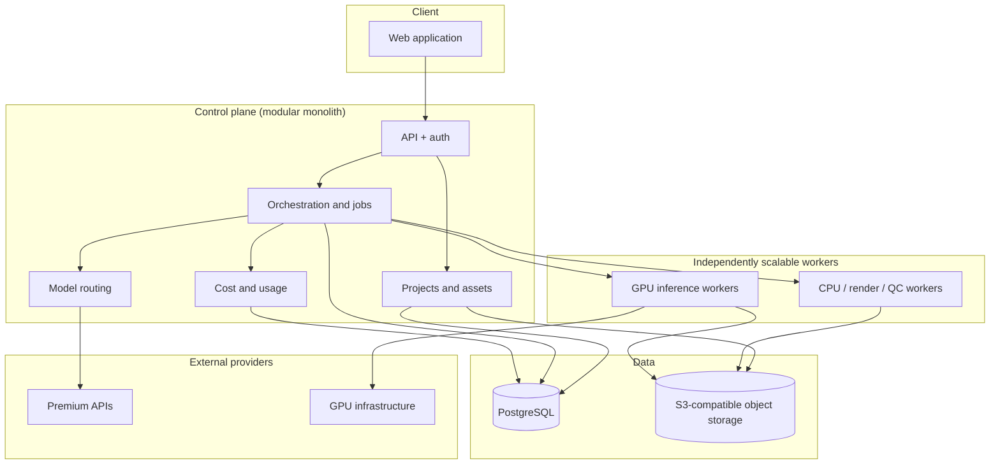

# Autonomous Reel Generator

A production-oriented platform for turning approved scripts into short-form videos through a reproducible, observable and cost-controlled pipeline.

> **Status: Milestone 0 discovery.** This repository currently contains engineering documentation, architectural decisions and a workflow reconstruction. The founder's scripts and media have not yet been inspected. There is no runnable application, no trained model, and no generated media in this repository. Claims about model quality or infrastructure performance in these documents refer to the founder's measured baseline where explicitly stated; everything else is marked as a target, assumption or open question.

## What this project is

Autonomous Reel Generator is the standalone successor to an existing AI video workflow built by Avinash Pandit. The existing workflow already produces Instagram Reels, YouTube Shorts and longer videos using a combination of paid APIs, open-weight models, rented GPUs and a coding assistant acting as the controller.

This project replaces that controller arrangement with an owned application: a durable orchestration layer, explicit approval gates, versioned assets, model routing, GPU lifecycle management, automated quality control and cost accounting. The production system must never depend on a coding assistant to execute a video.

The product is intended to become commercially deployable: initially a single-workspace studio tool, later multi-user and private/enterprise deployment.

## The pipeline we are reproducing

The plate sheet is a JSON document with one row per planned 2–6 second shot. Each row carries layout, A-roll, B-roll, motion-graphic intent, voiceover line, sound effects, caption and timing. The platform treats the plate sheet as a versioned planning artifact, not as an informal prompt.

Two workflow profiles exist and must not be conflated:

- **Explainer profile:** plates are timed against the generated voice track.
- **Character/story profile:** keyframes are generated and visually approved before voice and presenter generation.

## Architecture at a glance

The chosen starting point is a **modular monolith control plane plus independently scalable worker tiers**. It is deliberately not a microservice fleet. Modules have explicit boundaries so that CPU render workers, GPU inference workers and, later, tenant-facing services can be extracted when measurements justify it.

The reasoning, rejected alternatives and consequences are recorded in [ADR-001](docs/architecture/decisions/ADR-001-architecture-style.md), [ADR-002](docs/architecture/decisions/ADR-002-async-orchestration.md), [ADR-003](docs/architecture/decisions/ADR-003-model-routing.md), [ADR-004](docs/architecture/decisions/ADR-004-storage.md) and [ADR-005](docs/architecture/decisions/ADR-005-gpu-management.md).

## Documentation map

| Area | Documents |
|---|---|
| Product | [PRD](docs/product/PRD.md), [MVP scope](docs/product/MVP_SCOPE.md), [user flows](docs/product/USER_FLOWS.md), [acceptance criteria](docs/product/ACCEPTANCE_CRITERIA.md) |
| Architecture | [System architecture](docs/architecture/SYSTEM_ARCHITECTURE.md), [data flow](docs/architecture/DATA_FLOW.md), [component design](docs/architecture/COMPONENT_DESIGN.md), [job lifecycle](docs/architecture/JOB_LIFECYCLE.md), [asset lifecycle](docs/architecture/ASSET_LIFECYCLE.md), [security boundaries](docs/architecture/SECURITY_BOUNDARIES.md) |
| Decisions | [ADR-001 architecture style](docs/architecture/decisions/ADR-001-architecture-style.md), [ADR-002 async orchestration](docs/architecture/decisions/ADR-002-async-orchestration.md), [ADR-003 model routing](docs/architecture/decisions/ADR-003-model-routing.md), [ADR-004 storage](docs/architecture/decisions/ADR-004-storage.md), [ADR-005 GPU management](docs/architecture/decisions/ADR-005-gpu-management.md) |
| Engineering | [Tech stack](docs/engineering/TECH_STACK.md), [repository structure](docs/engineering/REPOSITORY_STRUCTURE.md), [development guide](docs/engineering/DEVELOPMENT_GUIDE.md), [testing strategy](docs/engineering/TESTING_STRATEGY.md), [error handling](docs/engineering/ERROR_HANDLING.md), [observability](docs/engineering/OBSERVABILITY.md) |
| AI | [Model registry](docs/ai/MODEL_REGISTRY.md), [model routing](docs/ai/MODEL_ROUTING.md), [model evaluation](docs/ai/MODEL_EVALUATION.md), [licensing policy](docs/ai/LICENSING_POLICY.md), [quality gates](docs/ai/QUALITY_GATES.md), [provider abstraction](docs/ai/PROVIDER_ABSTRACTION.md) |
| Infrastructure | [GPU orchestration](docs/infrastructure/GPU_ORCHESTRATION.md), [cost optimization](docs/infrastructure/COST_OPTIMIZATION.md), [deployment](docs/infrastructure/DEPLOYMENT.md), [security](docs/infrastructure/SECURITY.md), [data retention](docs/infrastructure/DATA_RETENTION.md) |
| Project | [Execution plan](docs/project/EXECUTION_PLAN.md), [milestones](docs/project/MILESTONES.md), [risks](docs/project/RISKS.md), [open questions](docs/project/OPEN_QUESTIONS.md), [progress](docs/project/PROGRESS.md) |
| Discovery | [Existing workflow](docs/discovery/EXISTING_WORKFLOW.md), [dependency graph](docs/discovery/WORKFLOW_DEPENDENCY_GRAPH.md), [founder materials](docs/discovery/FOUNDER_MATERIALS_CHECKLIST.md), [baseline reproduction](docs/discovery/BASELINE_REPRODUCTION_PLAN.md), [unknown configurations](docs/discovery/UNKNOWN_CONFIGURATIONS.md), [architecture traceability](docs/discovery/ARCHITECTURE_TRACEABILITY.md) |

## Baseline facts versus targets

The founder's email supplies measured observations from the existing system. Those observations are the baseline this project must reproduce before optimising. Examples include:

- A tested 60-second short cost approximately **$9.06** including pod setup and tests; a repeat in the same style cost approximately **$1**.
- A RunPod pod takes approximately **12 minutes** to provision and downloads approximately **75 GB** of models; pods are terminated after each session.
- InfiniteTalk 480p production configuration measured approximately **368–425 seconds per 4-second burst**, plus approximately **465 seconds** for one-time model loading. InfiniteTalk 720p ran out of memory on an L40.
- Voice QC pass thresholds in the existing workflow are similarity approximately **0.96–0.97** and Whisper CER at or below **0.2**.
- Avi's measured mouth-opening baseline is mean **0.28**, P90 **0.42**, with approximately **68%** of frames open.

These are observations from one environment, not vendor benchmarks. They must be independently reproduced. The documents distinguish **tested**, **rejected**, **proposed** and **untested** items; see the [model registry](docs/ai/MODEL_REGISTRY.md) and [model evaluation](docs/ai/MODEL_EVALUATION.md).

## Phase 2 validation and planning documents

The following documents extend the foundation with architecture validation, open-source strategy, environment preparation, GPU provider strategy and the implementation roadmap:

- [Architecture review](docs/architecture/ARCHITECTURE_REVIEW.md)
- [Component interfaces](docs/architecture/COMPONENT_INTERFACES.md)
- [Failure recovery](docs/architecture/FAILURE_RECOVERY.md)
- [Open-source model strategy](docs/ai/OPEN_SOURCE_MODEL_STRATEGY.md)
- [Model benchmark plan](docs/ai/MODEL_BENCHMARK_PLAN.md)
- [Open-source dependencies](docs/infrastructure/OPEN_SOURCE_DEPENDENCIES.md)
- [Development environment](docs/infrastructure/DEVELOPMENT_ENVIRONMENT.md)
- [GPU provider strategy](docs/infrastructure/GPU_PROVIDER_STRATEGY.md)
- [Repository acquisition plan](docs/infrastructure/REPOSITORY_ACQUISITION_PLAN.md)
- [Implementation roadmap](docs/project/IMPLEMENTATION_ROADMAP.md)
- [Environment setup checklist](docs/project/ENVIRONMENT_SETUP_CHECKLIST.md)

## Milestone 0 discovery documents

Milestone 0 is in progress. The workflow has been reconstructed from the founder's written account; the scripts, models and media have not yet been inspected.

- [Existing workflow](docs/discovery/EXISTING_WORKFLOW.md)
- [Workflow dependency graph](docs/discovery/WORKFLOW_DEPENDENCY_GRAPH.md)
- [Founder materials checklist](docs/discovery/FOUNDER_MATERIALS_CHECKLIST.md)
- [Baseline reproduction plan](docs/discovery/BASELINE_REPRODUCTION_PLAN.md)
- [Unknown configurations](docs/discovery/UNKNOWN_CONFIGURATIONS.md)
- [Architecture traceability](docs/discovery/ARCHITECTURE_TRACEABILITY.md)

## Getting started

Nothing is runnable yet. To participate in the foundation phase:

1. Read [AGENTS.md](AGENTS.md) if you are an AI coding agent, and [CONTRIBUTING.md](CONTRIBUTING.md) if you are a human contributor.
2. Read the [execution plan](docs/project/EXECUTION_PLAN.md) and [milestones](docs/project/MILESTONES.md).
3. Review the [open questions](docs/project/OPEN_QUESTIONS.md); several block Milestone 0.
4. Do not install application dependencies or scaffold services until Milestone 0's audit is complete.

## Repository rules

- The default branch is `main`. Every change is committed and pushed.
- Never commit secrets, private footage, customer media or model weights. Use [.env.example](.env.example) as the variable contract, never as a place for values.
- Generated media and evaluation artifacts live in object storage, not Git.
- Do not describe a capability as implemented until it has been reproduced and measured.
- Model licences must be verified before any commercial use; downloadable weights are not automatically usable. See the [licensing policy](docs/ai/LICENSING_POLICY.md).

## Ownership and licensing

Product direction and original workflow: Avinash Pandit. Repository and engineering: Madhavan. The repository is currently public but no open-source licence has been granted; do not assume reuse rights. Licensing of the product itself is an open question tracked in [OPEN_QUESTIONS.md](docs/project/OPEN_QUESTIONS.md).
