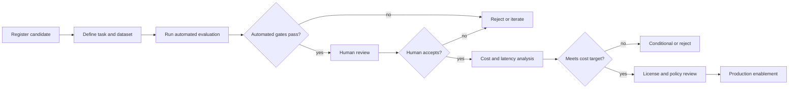

# Model Evaluation

| Field | Value |
|---|---|
| Status | Foundation |
| Last updated | 2026-11-27 |
| Related | [Model registry](MODEL_REGISTRY.md), [model routing](MODEL_ROUTING.md), [quality gates](QUALITY_GATES.md), [licensing policy](LICENSING_POLICY.md) |

## 1. Purpose

Model evaluation exists to prevent two failure modes: replacing a working model with an unproven one, and keeping an expensive model because nobody measured a cheaper alternative.

Every model, including the current baselines, must have an evaluation record before production enablement. Evaluation is not a one-time benchmark; it is a repeatable process tied to a dataset, a hardware configuration and a version.

## 2. Evaluation principles

- **Measure cost per accepted output**, not unit price or raw speed.
- **Use fixed datasets** so comparisons are fair.
- **Pin hardware, model version and settings**; results are not transferable across configurations without evidence.
- **Include human review** for creative quality; automated metrics are screening tools.
- **Record failures** as carefully as successes.
- **Do not compare a tuned baseline against an untuned challenger** without stating the difference.
- **Separate screening from certification.** A model can pass automated gates and still fail human review.

## 3. Evaluation lifecycle



Each step produces an artifact. A candidate that fails at any step remains in the registry with the failure reason.

## 4. Evaluation dataset

An evaluation dataset must include:

- approved scripts and plate sheets representative of the target formats,
- character references and proof visuals,
- voice and video references where applicable,
- expected durations and aspect ratios,
- a defined gold standard or reviewer rubric,
- edge cases: mixed languages, numbers, names, short and long beats, low-quality inputs.

The dataset is versioned. Results are only comparable across runs that use the same dataset version.

## 5. Automated metrics by capability

### 5.1 Voice

- Speaker similarity against the reference.
- Whisper transcript accuracy and CER.
- Syllables per second.
- Pronunciation of names, numbers and mixed-language phrases.
- Pause distribution and loudness after mastering.
- Failure rate and retry count.

### 5.2 Image

- Identity consistency across references.
- Prompt adherence judged by structured rubric.
- Artifact detection (distortion, extra limbs, text errors).
- Resolution and format validity.
- Generation time and cost.

### 5.3 Motion

- Frame stability and flicker.
- Temporal consistency.
- Motion beat duration compliance.
- Failure rate and retry count.
- Cost per accepted clip.

### 5.4 Lip-sync

- SyncNet score.
- MediaPipe mouth-opening metrics compared with the measured baseline.
- Jaw over-stretch detection.
- Head and facial movement preservation.
- Hindi/English phoneme handling.

### 5.5 Render and audio

- Frame rate correctness.
- Loudness and true peak.
- Black/duplicate frame detection.
- Caption sync.
- Render reproducibility from the manifest.

## 6. Human review

Human review uses a defined rubric and at most two scored candidates per shot, matching the editorial rule.

Reviewers record:

- identity and role,
- candidate comparison method,
- specific defects,
- overall accept/reject,
- whether the result is exportable,
- override reasons if applicable.

A model that passes automated metrics but fails human review is not production-ready. The failure is recorded with enough detail to guide future iteration.

## 7. Cost per accepted output

The primary economic metric is:

```text
cost_per_accepted_output =
  (total inference cost + setup cost + loading cost + failed attempt cost + review cost)
  / number of accepted outputs
```

Rules:

- Include failed attempts and retries.
- Include model loading and provisioning time.
- Include human review time where it is a real cost.
- Compare against the measured baseline, not against a theoretical optimum.
- Do not claim a reduction without a measured comparison.

## 8. Reproducibility

An evaluation record must include:

- candidate model ID and version
- deployment digest and weight hash
- dataset version
- hardware type, region and provider
- settings and prompts
- code revision
- timings and cost
- raw metric outputs
- human review notes
- conclusion and recommendation

The evaluation must be runnable again by another engineer using the same inputs.

## 9. Regression and re-evaluation

Re-evaluate when:

- a model version changes,
- a provider changes pricing or behaviour,
- hardware changes,
- the dataset changes,
- a quality incident occurs,
- a licence or terms change.

Regression evaluation can be a subset if justified, but the justification must be recorded. A model that previously passed must not be assumed to still pass after an upstream change.

## 10. Comparison protocol

When comparing two models for the same capability:

1. Use the same dataset and hardware where possible.
2. Use the same prompts and settings, adapted only where the model requires it.
3. Run both to completion, including retries.
4. Apply the same automated metrics and human rubric.
5. Record cost per accepted output.
6. Record failure modes, not just averages.
7. State whether the challenger is being evaluated as a replacement, a fallback or an addition.

A faster or cheaper model is not a replacement unless it meets the quality floor. A model that is better on one metric but worse on the overall rubric is not a replacement.

## 11. Production enablement

A model may be enabled in production only when:

- its registry entry is complete,
- its licence status is `allowed` or `allowed_with_conditions` with conditions recorded,
- its evaluation record shows it meets the quality floor for at least one profile,
- its cost and latency are recorded,
- its hardware requirements are documented,
- a live smoke test has passed,
- the product owner accepts the trade-off.

Enablement is recorded in the registry and audit trail.

## 12. Open questions

- What constitutes a sufficient dataset size for each capability.
- How to weight human review against automated metrics.
- Whether to use blind comparison for all evaluations.
- How to handle nondeterministic providers.
- Whether to evaluate models on customer-specific data under consent.

Tracked in [OPEN_QUESTIONS.md](../project/OPEN_QUESTIONS.md).
