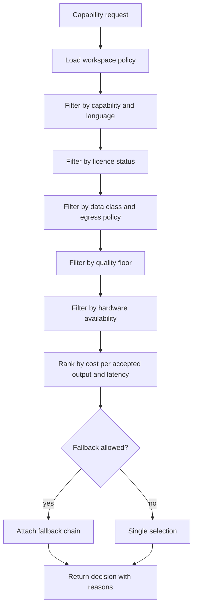

# Model Routing

| Field | Value |
|---|---|
| Status | Foundation |
| Last updated | 2026-11-27 |
| Related | [Model registry](MODEL_REGISTRY.md), [model evaluation](MODEL_EVALUATION.md), [quality gates](QUALITY_GATES.md), [provider abstraction](PROVIDER_ABSTRACTION.md), [ADR-003](../architecture/decisions/ADR-003-model-routing.md) |

## 1. Purpose

Routing turns a capability request into a concrete model deployment. It is the mechanism by which the system uses cheaper or private models without silently degrading quality or violating policy.

The application never names a model. It asks for a capability and constraints; routing returns a decision and the reasons for it.

## 2. Capabilities

| Capability | Typical use |
|---|---|
| `voice.synthesize` | Voice generation |
| `image.keyframe` | Still generation |
| `image.edit` | Multi-reference editing |
| `video.image_to_video` | Motion generation |
| `presenter.avatar` | Avatar video |
| `lipsync.generate` | Lip-sync |
| `graphics.compose` | Editorial composition |
| `audio.music` | Music generation or selection |
| `qc.transcribe` | Transcription |
| `qc.lipsync` | Lip-sync QC |
| `qc.mouth` | Mouth metrics |

Capabilities are stable identifiers; providers and models are variables.

## 3. Routing inputs

A routing request includes:

- capability
- language and script
- workflow profile
- quality profile (`draft`, `baseline`, `high`)
- data class of the inputs
- workspace policy version
- budget and latency targets
- required hardware availability
- whether a fallback is allowed

## 4. Decision process

Each filter records why a candidate was rejected. The final decision is auditable.

## 5. Quality floors

A model may be selected only if it is expected to meet the quality floor for the profile:

| Profile | Voice | Lip-sync | Image | Motion |
|---|---|---|---|---|
| `draft` | Preview only, not exportable | Preview only | Low-res candidate | Short beat, preview |
| `baseline` | Established QC thresholds | Established QC thresholds | Approved still quality | ≤ 2.4 s, approved still |
| `high` | Stricter thresholds or premium provider | Stricter thresholds | Higher resolution/detail | Longer or higher-detail beats |

Draft outputs cannot be exported. A route that would use a draft-quality model for an exportable run is rejected unless a human explicitly accepts the risk.

## 6. Cost and latency

- Routing ranks candidates by **cost per accepted output**, not by unit price. A cheaper model with a lower pass rate can be more expensive.
- Latency targets are considered for interactive operations; batch generation can wait for cheaper capacity.
- Warm-pool state can make a more expensive but resident model cheaper than a cheaper but cold one.
- Cost estimates are recorded at dispatch and settled at completion.

## 7. Privacy and egress

- Workspace policy determines which providers may receive which data classes.
- A model hosted in a private or customer-managed environment is preferred for restricted data when it meets the quality floor.
- External providers receive the minimum data required for the capability.
- A route that requires egress not permitted by policy is rejected, not silently downgraded to a local model that does not meet quality.

## 8. Fallback chains

A fallback chain is an ordered list of candidates. Fallback is triggered by:

- provider outage or rate limit,
- GPU pool unavailability,
- budget exhaustion,
- quality failure requiring a stronger model (escalation, not degradation).

Rules:

- A fallback may not cross a quality floor without approval.
- A fallback that changes cost materially must be visible in the run record.
- Escalation to a stronger model is allowed; degradation to a weaker one requires an audited override.
- Fallback decisions are stored with reasons.

## 9. Overrides

Authorized users can override routing within policy:

- Select a specific model version for a run or shot.
- Force a premium provider for quality reasons.
- Disable a model temporarily.

Overrides are audited and are subject to licence and egress policy. An override cannot enable an excluded or unlicensed model.

## 10. Caching and warm pools

- Routing considers whether a model is already resident and warm.
- A warm pool can make a slightly more expensive model the better choice.
- Cold-start penalties are recorded as part of routing cost.
- Routing does not provision GPU capacity; it selects a deployment and the GPU lifecycle provisions or reuses a session.

## 11. Examples

### 11.1 Voice for an explainer run

1. Capability `voice.synthesize`, language Hindi/English, profile `baseline`.
2. Policy allows ElevenLabs for confidential data.
3. ElevenLabs v4 is licensed (contract-dependent) and meets the quality floor.
4. Route to ElevenLabs v4. No fallback to an open model is allowed for exportable voice because no open model has passed evaluation.

### 11.2 Keyframe generation

1. Capability `image.keyframe`, profile `baseline`.
2. Qwen-Image + Lightning LoRA is tested and meets the baseline for this use.
3. Route to the registered Qwen deployment if licence status is `allowed` or `allowed_with_conditions`.
4. If the Qwen deployment is unavailable, the run waits or escalates; it does not silently substitute an unlicensed or untested model.

### 11.3 Presenter shot with budget pressure

1. Capability `presenter.avatar`, profile `baseline`.
2. HeyGen Avatar 6 is the only model that meets the quality floor in tested conditions.
3. If budget is exhausted, the shot is paused for approval rather than routed to an untested open model.

## 12. Routing output

A routing decision contains:

- selected model version and deployment
- capability and profile used
- fallback chain
- rejected candidates with reasons
- estimated cost and latency
- policy and licence evidence
- quality-floor evidence
- timestamp and policy version

This record is stored with the run and is part of the manifest.

## 13. Open questions

- How to calibrate quality floors from evaluation data.
- Whether routing should consider user preference as an input.
- Whether to support per-shot model overrides in the MVP.
- How to estimate cost for credit-based providers.
- Whether to route based on real-time GPU price.

Tracked in [OPEN_QUESTIONS.md](../project/OPEN_QUESTIONS.md).
