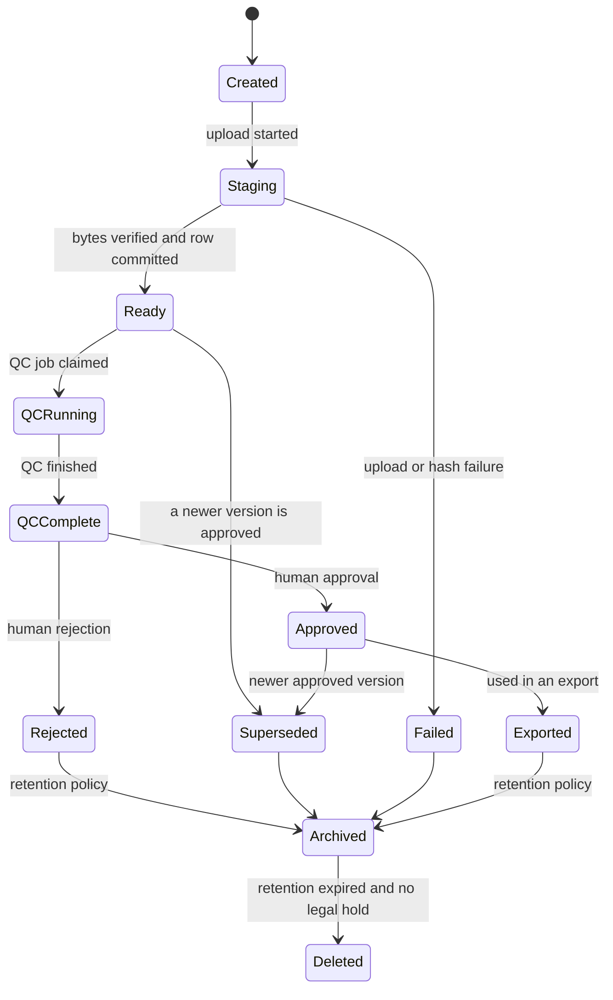

# Asset Lifecycle

| Field | Value |
|---|---|
| Status | Provisional |
| Last updated | 2026-11-27 |
| Related | [Data flow](DATA_FLOW.md), [component design](COMPONENT_DESIGN.md), [data retention](../infrastructure/DATA_RETENTION.md), [security boundaries](SECURITY_BOUNDARIES.md) |

## 1. Purpose

An asset is a logical media object with a stable identity across versions. A version is immutable bytes plus metadata. The asset layer is what makes shot-level regeneration and reproducibility possible without rewriting history.

## 2. Asset classes

| Class | Examples | Notes |
|---|---|---|
| `script` | Script text | Stored as a versioned text object, not necessarily in object storage |
| `plan` | Plate sheet JSON | Versioned document |
| `audio.voice` | Voice takes | One or more takes per plate |
| `image.keyframe` | Stills | Per shot, per candidate |
| `video.motion` | Image-to-video clips | Per shot |
| `video.presenter` | Avatar or lip-sync segments | Per shot |
| `graphics.project` | HyperFrames composition | Project files and rendered preview |
| `audio.mix` | Mixed and mastered audio | Per run |
| `video.render` | Final master | Per run |
| `qc.evidence` | Contact sheets, metric reports, extracted frames | Per asset version |
| `export.bundle` | Export package | Per export |
| `consent` | Voice and likeness consent records | Restricted class |

## 3. Lifecycle states



| State | Meaning |
|---|---|
| `Created` | Identity exists; no bytes yet |
| `Staging` | Bytes are uploading or being processed |
| `Ready` | Bytes verified and metadata committed; available for use |
| `QCRunning` / `QCComplete` | QC status tracked without mutating bytes |
| `Approved` | Human or policy approval recorded |
| `Rejected` | Explicitly rejected; retained for audit |
| `Superseded` | Replaced by a newer approved version; remains retrievable |
| `Archived` | Retained but not used in new work |
| `Exported` | Used in an export; deletion may be restricted |
| `Deleted` | Bytes and metadata removed per policy |

A version never moves backward. Rejection or supersession does not delete bytes immediately.

## 4. Versioning rules

1. Every write creates a new version. There is no in-place update of asset bytes or provenance.
2. The asset identity is stable across versions; the version ID is unique.
3. A version records its parent version, if any, and the reason for creation (initial, regeneration, retry, override).
4. An approved version remains immutable. A later regeneration creates a new version and marks the old one `Superseded`.
5. A version cannot be deleted while it is referenced by an approved run, export or consent record unless a documented deletion workflow overrides that reference.
6. Hashes are content-addressed. Two versions with the same hash in the same workspace may share bytes, but their metadata and provenance remain separate unless explicitly deduplicated and policy allows it.

## 5. Storage layout

Object storage is private. Keys are content-addressed or run-scoped, never user-controlled.

```text
workspace/{workspace_id}/assets/{asset_id}/{version_id}/original
workspace/{workspace_id}/assets/{asset_id}/{version_id}/derived/{kind}
workspace/{workspace_id}/runs/{run_id}/exports/{export_id}/...
workspace/{workspace_id}/qc/{asset_version_id}/...
```

Rules:

- The API never exposes a storage key directly; it issues a short-lived signed URL after authorization.
- Staging objects use a separate prefix and are cleaned by a sweeper.
- Content-addressed keys allow integrity checks and deduplication.
- Derived artifacts (contact sheets, extracted frames, normalized audio) are separate versions or QC evidence, not silent replacements.
- Large uploads use multipart or pre-signed URLs; the API validates metadata after upload.

## 6. Provenance

Every version stores the provenance defined in [DATA_FLOW.md](DATA_FLOW.md). The minimum required fields are:

- content hash and size
- MIME type and format details
- model and deployment identifiers where generated
- provider and provider job identifiers
- settings hash
- input version identifiers
- run, stage and shot identifiers
- hardware and region
- timing and cost entry references
- QC report references
- consent references where applicable
- code revision
- creator (user or system)

Provenance is part of the version's identity for audit purposes. It is not editable after creation.

## 7. Quality and approval

- QC runs against a specific asset version and stores its report immutably.
- A QC report references the metric definitions and threshold configuration used.
- Approval attaches to a specific asset version and gate.
- Re-running QC on an existing version creates a new report; it does not change the version.
- A version used in an export must have the QC status required by policy, or an explicit audited override.

## 8. Consent

- Voice and likeness assets link to consent records.
- A consent record states scope, owner, granted by, granted at, expiry and revocation.
- Revocation does not automatically delete existing exports, but it blocks new exports and new generation using that likeness or voice.
- Consent references are included in the export manifest.
- Biometric data is a restricted class under [DATA_RETENTION.md](../infrastructure/DATA_RETENTION.md).

## 9. Caching and reuse

- Cache reuse is by idempotency key and content hash, not by display name.
- Reuse across workspaces is forbidden unless the asset is explicitly marked shareable and policy allows it.
- A reused artifact is recorded as a cache hit with the original provenance; it does not get new authorship.
- Cache invalidation happens through upstream approval changes, model version changes and settings changes, not through time alone.
- Temporary worker files are never treated as assets.

## 10. Deletion and retention

- Deletion requests remove media bytes and derived artifacts according to policy.
- Audit records and cost entries are retained as required, even when media is deleted.
- Legal holds block deletion and are recorded.
- Superseded versions may be archived to cheaper storage before deletion.
- Deletion is asynchronous and idempotent; a deletion job records what it removed and what it could not remove.
- Orphaned staging objects are cleaned by a sweeper that compares object storage prefixes with database references.

See [DATA_RETENTION.md](../infrastructure/DATA_RETENTION.md) for retention periods and deletion workflows.

## 11. Export interaction

- Export creates an immutable `Export` record referencing exact asset versions, approvals, QC reports and cost entries.
- Exported bytes are stored under a run-scoped prefix.
- Re-exporting after a change creates a new export; it does not overwrite the old one.
- The manifest must be sufficient to reproduce the export given the same inputs and model versions, subject to documented provider nondeterminism.

## 12. Failure handling

- A failed upload leaves a staging object that the sweeper removes.
- A hash mismatch quarantines the object and fails the job with a clear error.
- A missing storage object referenced by a database row is a critical incident; the system must not serve a broken asset as complete.
- Partial derivatives are not published; the asset remains in `Staging` or `Failed`.
- A provider that returns success without bytes is treated as a failure, not as an empty asset.

## 13. Open questions

- Whether to store voice as one continuous track, per-plate clips, or both.
- Whether derived artifacts should be separate versions or QC evidence only.
- Whether content-addressed deduplication is enabled across a workspace or only within a run.
- Whether archived assets move to cold storage automatically or by administrator action.
- How to represent multi-track audio and caption assets in the registry.

Tracked in [OPEN_QUESTIONS.md](../project/OPEN_QUESTIONS.md).
