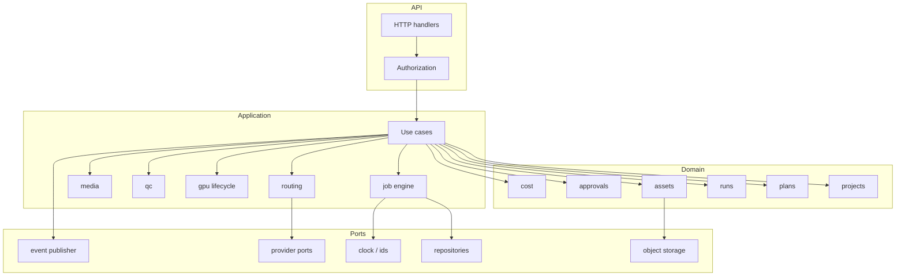

# Component Design

| Field | Value |
|---|---|
| Status | Provisional design for Milestone 2; interfaces will be validated by the code audit |
| Last updated | 2026-11-27 |
| Related | [System architecture](SYSTEM_ARCHITECTURE.md), [repository structure](../engineering/REPOSITORY_STRUCTURE.md), [error handling](../engineering/ERROR_HANDLING.md) |

## 1. Design rules

1. **Domain first.** State machines, invariants and approval rules live in a domain package with no FastAPI, SQLAlchemy or provider SDK imports.
2. **Explicit transactions.** A use case defines its transaction boundary. Object storage writes happen outside the database transaction and are reconciled by hash.
3. **Idempotent by construction.** Every job carries an idempotency key with a uniqueness constraint. Re-delivery is safe.
4. **No hidden I/O in domain code.** Providers, clocks, ID generation and storage are injected ports.
5. **One writer per state transition.** Job completion is a compare-and-set on job state and lease token; a stale worker cannot overwrite a newer attempt.
6. **Fail closed on policy.** Missing licence, missing consent or missing egress permission means the capability is unavailable, not "try anyway".

## 2. Module catalog



### 2.1 Identity and access

- Authenticate users, issue sessions, hash passwords with Argon2id, enforce role checks.
- Authorization is checked in the application service, not only in the route handler.
- Every query for tenant-owned data includes the workspace scope. Repositories expose scoped methods rather than a generic `get_by_id`.
- Audit login failures, role changes and credential changes.

### 2.2 Workspace policy

- Holds provider egress allowlist, data-class rules, retention settings, quality profile and budget policy.
- Policy is versioned. A run snapshots the policy version used for routing.
- A policy change does not retroactively authorize an in-flight egress; the run record shows which policy applied.

### 2.3 Projects and plans

- Owns project metadata, immutable script versions, plate sheets and plates.
- Validates plate structure, timing bounds, asset references and profile-specific gates.
- Approval is a separate domain action with actor, timestamp, version and comment.
- A plan edit after approval creates a new draft; it never mutates the approved sheet.

### 2.4 Runs and stages

- Creates a run snapshot: script version, plate sheet version, configuration, policy version, code revision.
- Materializes the stage graph for the selected profile.
- Tracks stage state, gate state, cancellation and overall run status.
- Rejects invalid transitions (for example, render before all required shots are approved).
- A run status is derived from its stages and gates, not set directly by a worker.

### 2.5 Asset registry

- Assigns stable asset identity and immutable versions.
- Stores content hash, MIME type, dimensions/duration, storage key, provenance and QC links.
- Enforces that a new version does not overwrite bytes under an existing version.
- Provides signed download URLs only after authorization.
- Tracks consent links for voice and likeness assets.

### 2.6 Job engine

- Claims jobs with `FOR UPDATE SKIP LOCKED`, creates an attempt and a lease.
- Requires heartbeats; expired leases become reclaimable.
- Enforces attempt limits, backoff and dead-letter state.
- Runs `preflight` before any paid dispatch.
- Completes a job only when the expected artifact is validated.
- Emits domain events in the same transaction as state changes (outbox pattern if needed).

### 2.7 Model routing

- Resolves capability + profile + language + policy to a model version and deployment.
- Applies quality floors, licence status, cost ceiling, latency target and fallback chain.
- Returns a `RoutingDecision` with reasons, not just a model name.
- Refuses to route when the only candidates are unlicensed, unavailable or below the quality floor.

### 2.8 Provider adapters

- One adapter per provider API, not per model. Model selection is a parameter.
- Normalize provider errors into the application error taxonomy.
- Normalize usage and cost into a `ProviderUsage` record.
- Support idempotency keys where the provider does; otherwise expose a reconciliation query.
- Never log request bodies containing media or credentials.

### 2.9 GPU lifecycle

- Selects a pool by capability, hardware requirement, region and policy.
- Provisions or reuses a session; waits for model server health and warm-up.
- Leases a session to one job at a time unless the model server explicitly supports concurrent compatible jobs.
- Records provisioning, model load, inference and teardown timings.
- Enforces idle shutdown and a hard session maximum.
- Reconciles provider state before declaring a session lost or creating a replacement.

### 2.10 Media and render

- Probes inputs with FFprobe and rejects unsupported or corrupt media before GPU work.
- Normalizes audio and video where required by the stage contract.
- Composes graphics through the HyperFrames/HTML/GSAP runtime and renders with FFmpeg.
- Produces a render manifest with timeline, fonts, assets and settings.
- Verifies output frame rate, duration, audio loudness and true peak.

### 2.11 Quality control

- Runs metric adapters (Whisper, SyncNet, MediaPipe, similarity, black/duplicate frame detection).
- Stores raw measurements, threshold configuration and the decision.
- Distinguishes `pass`, `warn`, `fail` and `needs_human`.
- Never edits an asset; QC only evaluates and records.
- Supports re-running QC on an existing asset version without regenerating it.

### 2.12 Cost ledger

- Records estimated cost at dispatch and actual cost at completion.
- Attributes to workspace, run, stage, shot, provider and GPU session.
- Treats failed provider calls as cost events when the provider charges.
- Supports budget reservations so concurrent jobs cannot all pass a check and then overspend.
- Reconciles against provider billing exports; discrepancies are visible, not smoothed away.

### 2.13 Audit

- Append-only events for approvals, overrides, exports, role changes, credential changes, policy changes and deletions.
- Includes actor, action, target, timestamp, request ID and relevant before/after metadata.
- Excludes secrets and media content.

## 3. Domain invariants

These are enforced in the domain layer and backed by database constraints where possible.

| ID | Invariant |
|---|---|
| INV-001 | An approved script version is immutable. |
| INV-002 | An approved plate sheet version is immutable. |
| INV-003 | A run references exact versions of script, plate sheet, configuration and policy. |
| INV-004 | Motion generation requires an approved keyframe version for the same shot. |
| INV-005 | A motion clip longer than the configured maximum is split or explicitly flagged; it is never silently accepted. |
| INV-006 | A presenter or lip-sync asset cannot be exported without a QC report and the required approval. |
| INV-007 | A job cannot be `succeeded` without a validated artifact matching its output contract. |
| INV-008 | An asset version's bytes are immutable; changes create a new version. |
| INV-009 | Cost entries are append-only; corrections are new entries with a reason. |
| INV-010 | An approval records actor, role, timestamp, target version and decision. |
| INV-011 | Export requires all blocking gates to be closed or explicitly waived by an authorized actor. |
| INV-012 | A workspace cannot route to a provider that its policy does not allow for the data class. |
| INV-013 | A production route requires a licence decision of `allowed` or `allowed_with_conditions` with recorded conditions. |
| INV-014 | A GPU session has at most one active lease unless concurrency is explicitly declared. |
| INV-015 | A stale worker cannot complete a job after its lease has been reassigned. |

## 4. Key interfaces

Illustrative Python protocols; names may change during implementation.

```python
class ProviderPort(Protocol):
    capability: ClassVar[Capability]

    async def execute(
        self,
        request: ProviderRequest,
        ctx: CallContext,
    ) -> ProviderResult: ...

    async def reconcile(
        self,
        provider_job_id: str,
        ctx: CallContext,
    ) -> ProviderResult | None: ...


@dataclass(frozen=True)
class CallContext:
    workspace_id: WorkspaceId
    run_id: RunId
    stage_id: StageId
    shot_id: ShotId | None
    idempotency_key: str
    deadline: datetime
    trace_id: str
    policy_version: int
```

```python
class JobQueue(Protocol):
    async def claim(
        self,
        worker: WorkerId,
        classes: Sequence[JobClass],
        lease: timedelta,
    ) -> ClaimedJob | None: ...

    async def heartbeat(
        self,
        job_id: JobId,
        lease_token: LeaseToken,
        extend: timedelta,
    ) -> None: ...

    async def complete(
        self,
        job_id: JobId,
        lease_token: LeaseToken,
        outcome: JobOutcome,
    ) -> None: ...
```

```python
class RoutingPort(Protocol):
    async def resolve(
        self,
        capability: Capability,
        requirements: RoutingRequirements,
        ctx: RoutingContext,
    ) -> RoutingDecision: ...
```

`RoutingDecision` includes the selected model version, deployment, fallback chain, quality-floor evidence, estimated cost and the reasons for rejection of other candidates.

## 5. API surface (provisional)

| Method | Path | Purpose |
|---|---|---|
| `POST` | `/v1/projects` | Create project |
| `GET` | `/v1/projects/{project_id}` | Project detail |
| `POST` | `/v1/projects/{project_id}/scripts` | Add immutable script version |
| `POST` | `/v1/projects/{project_id}/plans` | Generate or create a plate sheet draft |
| `PATCH` | `/v1/plans/{plan_id}` | Edit a draft plan |
| `POST` | `/v1/plans/{plan_id}/approve` | Approve a plan version |
| `POST` | `/v1/runs` | Create a run from approved inputs |
| `GET` | `/v1/runs/{run_id}` | Run status, stages, gates, cost |
| `POST` | `/v1/runs/{run_id}/cancel` | Cancel a run |
| `POST` | `/v1/runs/{run_id}/stages/{stage}/retry` | Retry a stage |
| `POST` | `/v1/shots/{shot_id}/regenerate` | Regenerate a shot |
| `GET` | `/v1/shots/{shot_id}/candidates` | Scored candidates and evidence |
| `POST` | `/v1/approvals` | Record an approval or rejection |
| `GET` | `/v1/assets/{asset_id}/versions/{version}/download-url` | Short-lived signed URL |
| `POST` | `/v1/runs/{run_id}/export` | Request export |
| `GET` | `/v1/runs/{run_id}/manifest` | Provenance and cost manifest |
| `GET` | `/v1/admin/models` | Registry administration |
| `GET` | `/v1/admin/costs` | Cost reporting |

Rules:

- All mutations require an idempotency key header.
- List endpoints are cursor-paginated and workspace-scoped.
- Errors use a stable code, human message, retryable flag and correlation ID.
- Long operations return `202` with a job/run resource; they never block the HTTP request until inference finishes.

## 6. Transaction boundaries

### 6.1 Create run

```text
BEGIN
  verify approved plan version and policy
  create run + stage rows + snapshot
  enqueue first stage job
  write audit event
COMMIT
```

### 6.2 Complete a stage job

Object storage is not transactional with PostgreSQL. The pattern is:

```text
1. Worker uploads output to a staging key.
2. Worker verifies size, MIME type and content hash.
3. BEGIN
     compare-and-set job state using lease token
     insert asset version row referencing the staging key
     insert provenance and cost entry
     insert QC job or next stage job
     update stage state
     write outbox event
   COMMIT
4. A promoter moves/copies the staging object to its content-addressed key
   and marks the asset version readable. If promotion fails, the asset
   remains unreadable and the job is retried; it is never served as complete.
```

Alternatively, upload directly to the final content-addressed key before the transaction and record it; an orphan sweeper removes unreferenced objects. Either approach must guarantee that a database row never points to missing bytes.

### 6.3 Approval

```text
BEGIN
  lock the target plan/asset version
  verify actor role and gate state
  insert approval
  close gate or create next job
  write audit event
COMMIT
```

Approval must not be a UI-only flag. A worker must re-check the approval record at dispatch.

## 7. Concurrency and race conditions

| Race | Control |
|---|---|
| Two workers claim the same job | `SKIP LOCKED` + unique active lease constraint |
| Stale worker completes after lease expiry | Compare-and-set on lease token; reject stale completion |
| Approval arrives while a job is dispatching | Dispatch re-reads gate state in the same transaction as claim; if approval is missing, job returns to waiting |
| Plan changes after motion started | Plan version check at job claim; stale jobs are cancelled and marked superseded |
| Two GPU sessions provisioned for one job | GPU session table has a unique active assignment per job; provider reconciliation before create |
| Budget check passes twice | Reserve budget atomically before dispatch; settle actuals on completion |
| Duplicate provider charge on retry | Idempotency key + provider reconciliation before retry |
| Concurrent edits to a draft plan | Optimistic version check; last writer must rebase |
| Export while a gate is being overridden | Export transaction locks gate rows and re-checks |

## 8. Extension points

- **New provider:** implement `ProviderPort`, register capabilities, add contract tests, record licence and cost metadata.
- **New model version:** register in the model registry with deployment digest, hardware requirement, evaluation status and licence decision; route through policy, never by name in domain code.
- **New pipeline stage:** define input/output contracts, add a stage handler, add state transitions, update the stage graph and manifest.
- **New renderer:** implement the composition/render port; preserve the 25 FPS and manifest contract.
- **New QC metric:** implement a metric adapter, define threshold semantics, store raw evidence, add it to the gate policy.
- **New GPU provider:** implement the infrastructure port (provision, status, terminate, price) and a reconciliation test.

## 9. Testing seams

- Domain state machines are pure and unit-testable without a database.
- Repositories are tested against real PostgreSQL via containers.
- Provider adapters are tested with recorded HTTP fixtures plus a separate, cost-capped live smoke test.
- GPU lifecycle is tested against a fake provider that can simulate slow provisioning, preemption, hung health checks and orphaned sessions.
- Render and QC have golden-file or metric-tolerance tests using approved synthetic fixtures.
- The web application is tested against a running API, not a hand-written mock that can drift.

## 10. Open design questions

- Whether the outbox is required in the first implementation or whether synchronous next-job enqueue is sufficient.
- Whether asset promotion uses copy or multi-part upload directly to the final key.
- Whether GPU agents pull work or are driven by a provider-specific control channel.
- How provider cost is estimated when pricing is tiered or credit-based.
- Whether QC adapters run in-process or as isolated workers with pinned dependencies.
- How much of the existing Python tooling can be wrapped versus rewritten.

Tracked in [OPEN_QUESTIONS.md](../project/OPEN_QUESTIONS.md).
