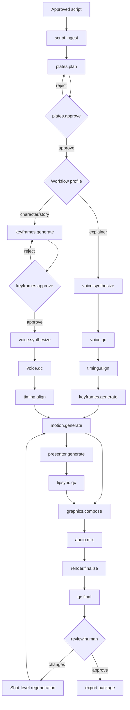

# Data Flow

| Field | Value |
|---|---|
| Status | Provisional; stage identifiers are the intended contract for Milestone 2 |
| Last updated | 2026-11-27 |
| Related | [System architecture](SYSTEM_ARCHITECTURE.md), [job lifecycle](JOB_LIFECYCLE.md), [asset lifecycle](ASSET_LIFECYCLE.md), [quality gates](../ai/QUALITY_GATES.md) |

## 1. Canonical objects

| Object | Meaning | Mutability |
|---|---|---|
| Project | Creative container: format, aspect ratio, language mix, profile | Mutable metadata; changes are audited |
| ScriptVersion | Immutable script text and metadata | Immutable after creation |
| PlateSheet | Versioned plan with one row per 2–6 second shot | New version on edit |
| Plate | One planned shot: layout, A-roll, B-roll, motion graphic, voiceover, SFX, caption, timing | Belongs to a sheet version |
| Run | One execution of an approved plan with a frozen snapshot | State machine; never rewritten silently |
| StageRun | Execution of one pipeline stage within a run | State machine |
| Job | Durable unit of work claimed by a worker | State machine |
| Attempt | One execution attempt of a job | Append-only |
| Asset | Logical media object (e.g., "shot 4 keyframe") | Identity stable across versions |
| AssetVersion | Immutable bytes plus provenance and QC | Immutable |
| Approval | Attributed decision at a gate | Immutable; superseded by a new approval |
| QcReport | Measurements and threshold decisions | Immutable per asset version |
| CostEntry | Cost attributed to run/stage/shot/provider | Append-only; corrections are new entries |
| Export | Final package and manifest | Immutable |

## 2. Canonical stage identifiers

These identifiers are used in the API, job records, manifests and dashboards. They are not provider names.

| Stage ID | Purpose | Produces |
|---|---|---|
| `script.ingest` | Validate and freeze the script version | `ScriptVersion` |
| `plates.plan` | Generate a structured plate sheet | `PlateSheet` draft |
| `plates.approve` | Human gate on the plan | `Approval` |
| `voice.synthesize` | Generate voice takes | `AssetVersion` (audio) |
| `voice.qc` | Similarity, transcript/CER, syllables/sec | `QcReport` |
| `timing.align` | Align plate timings to voice or planned visual timing | Timed `PlateSheet` version |
| `keyframes.generate` | Generate stills from plate descriptions | `AssetVersion` (image) |
| `keyframes.approve` | Human gate on keyframes (character/story) | `Approval` |
| `motion.generate` | Image-to-video from approved stills | `AssetVersion` (video) |
| `presenter.generate` | Avatar or lip-sync presenter segment | `AssetVersion` (video) |
| `lipsync.qc` | SyncNet and mouth-opening checks | `QcReport` |
| `graphics.compose` | Editorial graphics, proof visuals, captions | Composition project + preview |
| `audio.mix` | Music, SFX, voice bed, mastering | `AssetVersion` (audio) |
| `render.finalize` | 25 FPS master render | `AssetVersion` (video) |
| `qc.final` | Black/duplicate frames, duration, loudness, caption sync | `QcReport` |
| `review.human` | Final human gate | `Approval` |
| `export.package` | Export bundle and manifest | `Export` |

A stage may fan out into shot-level jobs. The stage is complete only when every required shot job is complete and validated.

## 3. End-to-end flow



The diagram shows the dependency shape, not a strict serial schedule. Independent shots can generate in parallel; audio and graphics can prepare while visual jobs run, provided their inputs are approved.

## 4. Explainer profile

1. Script is ingested and frozen.
2. Plate sheet is generated and approved. Durations are provisional.
3. Voice is generated and QC'd.
4. Timing is aligned to the approved voice track. Plate boundaries snap to 25 FPS frames; cumulative drift is corrected at each boundary.
5. Keyframes are generated from the timed plates.
6. Motion is generated per shot from approved stills, subject to the 2.4 s guidance.
7. Presenter/lip-sync is generated where the shot requires it.
8. Graphics and audio are composed.
9. Final render, QC, human review and export.

The voice track is the timing authority. If a plate's spoken line changes length, the plate duration changes and dependent motion jobs are invalidated.

## 5. Character/story profile

1. Script is ingested and frozen.
2. Plate sheet is generated and approved with planned durations.
3. Keyframes are generated from approved visual intent and character references.
4. Keyframes are visually approved before any voice or presenter spend.
5. Voice is generated against the approved visual timing and QC'd.
6. Motion and presenter segments are generated.
7. Graphics, audio, render, QC, review and export follow.

Visual approval is the timing authority. Voice may be trimmed or paused to fit the approved cut, but the system must not silently stretch video to cover a longer read.

## 6. Plate sheet shape

The plate sheet is JSON, versioned and validated. The following is an illustrative shape, not a final schema:

```json
{
  "schema_version": 1,
  "profile": "explainer",
  "fps": 25,
  "language": { "primary": "hi", "mixed": ["en"] },
  "plates": [
    {
      "id": "P001",
      "start_s": 0.0,
      "duration_s": 3.2,
      "layout": "presenter-left-proof-right",
      "a_roll": "Presenter: opening claim",
      "b_roll": "Real proof screenshot of the dashboard",
      "motion_graphic": "Yellow marker underline on the metric",
      "voiceover": "Prepared line with Devanagari and number words",
      "sfx": [{ "id": "marker-swipe", "at_s": 2.4 }],
      "caption": "Short caption text",
      "visual_refs": ["asset:proof-dashboard-v3"],
      "approval_state": "draft"
    }
  ]
}
```

Validation rules:

- `duration_s` is greater than zero and within the configured plate bounds (baseline 2–6 s).
- Every plate has a voiceover line or an explicit silent/ambient intent.
- Captions are present or explicitly disabled.
- Motion-graphic intent is described in editorial terms, not as an opaque prompt.
- Referenced assets exist and are approved for the workspace.
- Total duration matches the target format within tolerance.
- Frame rounding is explicit at 25 FPS.

## 7. Artifact and provenance flow

Every asset version carries a provenance record:

| Field | Example | Why |
|---|---|---|
| `asset_version_id` | `av_01J...` | Stable identity |
| `content_hash` | `sha256:...` | Deduplication and integrity |
| `mime_type` | `video/mp4` | Validation and rendering |
| `model_id` / `model_version` | registry key, not a display name | Reproducibility |
| `provider` | `elevenlabs`, `runpod`, `local` | Cost and policy attribution |
| `deployment_id` | pinned model server image/digest | Reproducibility |
| `settings_hash` | canonical JSON hash | Detect silent setting changes |
| `input_versions` | list of asset version IDs | Lineage |
| `run_id`, `stage_id`, `shot_id` | identifiers | Traceability |
| `gpu_type`, `region` | `A100-SXM-80GB`, `US-KS-2` | Performance analysis |
| `timing` | queue, load, inference, upload, total | Cost and optimisation |
| `cost_entry_ids` | ledger references | Attribution |
| `qc_report_ids` | evidence | Gates |
| `consent_ids` | voice/likeness consent | Compliance |
| `code_revision` | git SHA | Reproducibility |
| `created_at`, `created_by` | timestamp, actor or system | Audit |

The manifest is the human-readable projection of this record. It must be sufficient to explain how the output was made without reading application logs.

## 8. Idempotency and caching

A stage or shot job derives an idempotency key from:

```text
hash(
  stage_id,
  ordered input asset version hashes,
  model version and deployment digest,
  canonical settings,
  output specification,
  prompt/plate content where applicable
)
```

Rules:

- If a successful artifact exists for the same key and is still valid, reuse it and record a cache hit.
- Provider calls use the provider's idempotency mechanism where available; otherwise the system checks for an existing provider job before retrying.
- A settings change produces a new key; it never overwrites the old artifact.
- Cache reuse across workspaces is forbidden unless the asset is explicitly marked shareable and the policy allows it.
- Cache entries are invalidated by upstream approval changes, not by time alone.

## 9. Data classification and movement

| Class | Examples | Default handling |
|---|---|---|
| Public | Published video, public brand assets | May be served from a CDN |
| Internal | Draft plans, internal notes, cost reports | Workspace members only |
| Confidential | Unpublished footage, client scripts, voice samples | Encrypted at rest, signed URLs, no external egress without policy |
| Restricted | Biometric/likeness data, consent records, credentials | Strict need-to-know, audit every access, never in logs |

Movement rules:

- Browser uploads go directly to object storage using a short-lived signed URL; the API validates metadata and content type after upload.
- Workers download inputs using scoped credentials; GPU pods receive only the assets required for the claimed job.
- External providers receive the minimum data required for the capability. The egress decision is recorded.
- Logs and traces never contain media, full scripts, tokens or presigned URLs.
- Deletion follows [DATA_RETENTION.md](../infrastructure/DATA_RETENTION.md), including derivatives and caches.

## 10. Failure and partial completion

- A failed shot does not fail the whole run unless the stage requires every shot to proceed (for example, final render).
- Partial artifacts are quarantined, not published as candidates.
- A stage transition to `succeeded` requires artifact validation and, where applicable, QC completion.
- Retries reuse validated upstream artifacts by idempotency key.
- If timing changes after motion generation, affected motion assets are marked stale and cannot be used in the final render.
- A cancelled run stops new dispatch and marks in-flight jobs; it does not pretend that already-spent cost disappeared.

## 11. Open data questions

- Final plate JSON schema and migration policy.
- Whether voice takes are stored as one continuous track, per-plate clips, or both.
- Exact frame-boundary rounding rule for mixed-language pacing.
- Whether captions are authored in the plate sheet, generated from the final audio, or both.
- Which provider identifiers and billing fields are stable enough to store.
- Whether model weights can be content-addressed and pinned by hash in every deployment.

Tracked in [OPEN_QUESTIONS.md](../project/OPEN_QUESTIONS.md).
