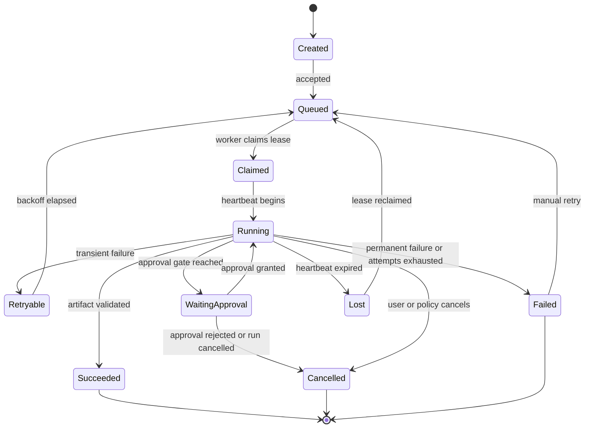
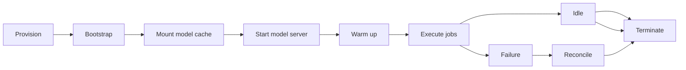

# Job Lifecycle

| Field | Value |
|---|---|
| Status | Provisional; state names are the intended contract |
| Last updated | 2026-11-27 |
| Related | [System architecture](SYSTEM_ARCHITECTURE.md), [component design](COMPONENT_DESIGN.md), [error handling](../engineering/ERROR_HANDLING.md), [observability](../engineering/OBSERVABILITY.md) |

## 1. Purpose

A job is the durable unit of work that a worker can claim. A run is not a job, and a stage is not a job. A stage may fan out into many jobs, and a job may be retried many times. The job table is the source of truth for what the system is doing right now.

## 2. Job classes

| Class | Examples | Queue |
|---|---|---|
| `preflight` | Validate inputs, probe media, resolve routing | CPU |
| `plan` | Generate plate sheet | CPU |
| `voice` | Synthesize and post-process voice | CPU + provider |
| `keyframe` | Generate stills | GPU image |
| `motion` | Image-to-video | GPU video |
| `presenter` | Avatar or lip-sync | GPU presenter |
| `graphics` | Compose editorial graphics | CPU |
| `render` | FFmpeg final render | CPU render |
| `qc` | Metrics and gate evaluation | CPU/QC |
| `export` | Package and manifest | CPU |
| `gpu_session` | Provision, warm, terminate | GPU control |
| `reconcile` | Recover lost sessions or jobs | CPU |

Each class has its own concurrency limit, timeout, retry policy and cost model.

## 3. Job states

| State | Meaning | Terminal? |
|---|---|---|
| `Created` | Row exists but is not yet dispatchable | No |
| `Queued` | Available for claim | No |
| `Claimed` | A worker holds a lease but has not started | No |
| `Running` | Worker is executing and heartbeating | No |
| `WaitingApproval` | Blocked on a human gate; no worker needed | No |
| `Retryable` | Failed transiently; scheduled for retry | No |
| `Lost` | Lease expired; awaiting reclaim | No |
| `Succeeded` | Completed with a validated artifact | Yes |
| `Failed` | Permanently failed or attempts exhausted | Yes |
| `Cancelled` | Stopped by user or policy | Yes |

`Succeeded` requires the output contract to be satisfied. A worker cannot declare success by finishing its process.

## 4. Attempt model

Each claim creates an `Attempt` with:

- attempt number
- worker identity
- lease token
- started at / heartbeat at / finished at
- input snapshot hash
- output artifact references
- error classification and detail
- cost entries
- provider job identifiers

Attempts are append-only. Replaying a job creates a new attempt; it never overwrites the old one. This is what makes post-mortems possible.

## 5. Leases and heartbeats

- A lease is time-bounded and uses database time, not worker time.
- Heartbeat interval is shorter than lease duration (baseline: heartbeat 30 s, lease 120 s).
- A worker that cannot heartbeat must stop work and release the job if possible.
- When a lease expires, the job becomes `Lost`, then reclaimable after a short grace period.
- Reclaiming a job increments a reclaim counter; repeated reclaims are a signal of a stuck dependency or a slow worker.
- A stale worker that continues after lease expiry cannot complete the job: completion is a compare-and-set on lease token.

## 6. Retry policy

Retry policy is per job class and is data, not code:

| Field | Meaning |
|---|---|
| `max_attempts` | Total attempts before `Failed` |
| `backoff` | Exponential with jitter, capped |
| `retryable_errors` | Error codes that may retry |
| `non_retryable_errors` | Error codes that fail immediately |
| `budget_sensitive` | Whether retry requires cost headroom |
| `retry_on_loss` | Whether a lost lease is retried automatically |

Rules:

- Retrying does not repeat completed paid work if an idempotency key resolves to an existing artifact.
- A retry of a provider call checks for an existing provider job before creating a new one.
- Attempt limits are enforced even under reclaim; a job cannot retry forever.
- A retry that would exceed budget pauses instead of failing silently.

## 7. Timeout policy

- Each job class has a soft warning threshold and a hard timeout.
- A hard timeout terminates the worker process or the provider call, then classifies the failure.
- Timeouts are measured from claim, not from enqueue, so queue wait is visible separately.
- A stage timeout is separate from a job timeout; a stage may have many jobs.

## 8. Cancellation

- A user or policy can cancel a run or a shot.
- Cancellation sets a flag and stops new dispatch.
- In-flight jobs are asked to cancel; if they cannot stop immediately, they are allowed to reach a safe checkpoint or are terminated at the hard timeout.
- Cancellation does not erase cost entries.
- A cancelled job cannot transition to `Succeeded`.
- GPU sessions owned by cancelled jobs are terminated by the lifecycle manager.

## 9. Approval gates

Gates are job states, not UI conveniences:

- `plates.approve` blocks `voice.synthesize` and `keyframes.generate` until an approval record exists.
- `keyframes.approve` blocks voice and presenter work in the character/story profile.
- `review.human` blocks `export.package`.
- A gate is closed by an `Approval` row with actor, role, timestamp, decision and comment.
- A rejected gate returns the dependency to a draft or failed state according to the stage contract.
- An override of a blocking gate requires an authorized role and records the reason; the override is visible in the manifest.

## 10. Preflight

Every GPU or paid job runs preflight before dispatch:

1. Validate input asset hashes and MIME types.
2. Validate plate and timing constraints.
3. Resolve model routing and licence status.
4. Check provider connectivity and egress policy.
5. Check budget headroom.
6. Check pool availability and model server health.
7. Reserve budget and create the cost estimate.

Preflight failure is cheap and prevents expensive failure. A preflight failure is not a retryable inference failure; it is usually configuration or policy.

## 11. GPU session lifecycle

- Provisioning includes pod creation, image pull and network attachment.
- Bootstrap installs or verifies the runtime dependencies.
- Model cache is a persistent volume or image layer; downloading ~75 GB per session is treated as an incident.
- Warm-up runs a representative request and records its latency.
- Execution batches compatible jobs when the model server supports it.
- Idle shutdown targets 5–10 minutes, configurable per pool.
- Termination is verified against provider state; a termination failure pages an administrator.

## 12. Dead-letter handling

A job reaches dead-letter when:

- attempts are exhausted,
- a non-retryable error occurs,
- it is cancelled after a policy breach, or
- it is quarantined by an operator.

Dead-letter jobs remain queryable with their attempts, errors and cost. They are not silently deleted. Recovery requires a manual retry or a configuration change.

## 13. Recovery scenarios

| Scenario | Recovery |
|---|---|
| Worker process crashes | Lease expires; job is reclaimed and retried |
| GPU pod is preempted | Attempt fails; new session is provisioned; completed shots are reused |
| Model server hangs | Health check and step timeout fail the attempt; session is terminated |
| Database failover | Workers stop claiming; in-flight jobs rely on heartbeat expiry; no duplicate completion due to lease token |
| Object storage outage | Preflight fails before GPU dispatch; retries after recovery |
| Provider outage | Capability degrades; retry with backoff; fallback only if policy allows |
| Cost budget exceeded | New dispatch pauses; running jobs follow policy; state is preserved |
| Clock skew | Leases use database time; workers compare against server-provided deadlines |

## 14. Observability fields

Every job record and log line must carry:

- `run_id`, `stage_id`, `shot_id` where applicable
- `job_id`, `attempt_id`, `lease_token`
- `job_class`, `queue`
- `worker_id`
- `model_version`, `deployment_id`
- `provider`, `provider_job_id`
- `gpu_pool`, `gpu_session_id`, `gpu_type`
- `idempotency_key`
- `trace_id`, `request_id`
- `created_at`, `claimed_at`, `started_at`, `heartbeat_at`, `finished_at`
- `error_code`, `retryable`
- `cost_estimate`, `cost_actual`

Without these fields, a failure cannot be diagnosed or cost cannot be attributed.

## 15. Open questions

- Whether `WaitingApproval` should be a job state or a stage state; it is modelled as both in this document and must be reconciled.
- Whether job classes can be added at runtime or must be registered in code.
- Whether dead-letter jobs should auto-expire and how long to retain them.
- Whether a stage can be retried without retrying its failed child jobs.
- How to handle a provider that returns success but no artifact.

Tracked in [OPEN_QUESTIONS.md](../project/OPEN_QUESTIONS.md).
