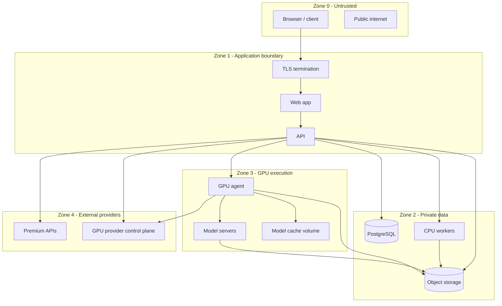

# Security Boundaries

| Field | Value |
|---|---|
| Status | Foundation; controls are requirements, not implemented yet |
| Last updated | 2026-11-27 |
| Related | [System architecture](SYSTEM_ARCHITECTURE.md), [infrastructure security](../infrastructure/SECURITY.md), [data retention](../infrastructure/DATA_RETENTION.md), [licensing policy](../ai/LICENSING_POLICY.md) |

## 1. Trust zones

Zone 0 is never trusted. Zone 1 is the controlled boundary. Zone 2 holds confidential data and must not be reachable from Zone 0 except through the API. Zone 3 is semi-trusted execution infrastructure: it can run untrusted model code and must be treated as hostile to Zone 2. Zone 4 is outside the trust boundary and is governed by contracts and policy.

## 2. Boundary principles

1. **Deny by default.** Network, storage, provider and data-class access are denied unless an explicit policy allows them.
2. **Least privilege.** Workers, GPU agents and providers receive only the assets and permissions needed for the claimed job.
3. **No direct data access from the browser.** The web app never talks to the database, object storage or providers directly.
4. **Zone 3 is hostile.** GPU pods run third-party model code. They receive scoped, short-lived credentials and only the inputs for the current job.
5. **Policy is data.** Egress and data-class decisions are stored, versioned and auditable.
6. **Secrets never cross zones in plaintext.** Credentials are stored in a secret manager and injected at runtime; they are not baked into images or committed.
7. **Signed URLs are capabilities, not identity.** A signed URL grants access to one object for a short time and is not a substitute for authorization.

## 3. Component trust and responsibilities

| Component | Zone | Trust | May access | Must not |
|---|---|---|---|---|
| Browser | 0 | Untrusted | Public assets via signed URLs | Database, storage API, provider APIs, secrets |
| TLS edge | 1 | Controlled | Route traffic | Store media, run jobs |
| Web app | 1 | Controlled | API only | Database, object storage, provider secrets |
| API | 1 | Controlled | DB, storage metadata, providers per policy | Bypass authorization, log secrets/media |
| CPU worker | 2 | Controlled | DB, storage, queue | Provider credentials beyond its job, Zone 3 directly except through API |
| GPU agent | 3 | Semi-trusted | Claimed job inputs, output upload, heartbeat | Arbitrary DB queries, other workspaces' assets, secrets |
| Model server | 3 | Untrusted code | Model weights, job inputs, output path | Network outside the pod, credential store |
| Premium providers | 4 | External | Only the data explicitly sent | Retention assumptions, deletion guarantees without contract |

## 4. Authentication and sessions

- Users authenticate with strong password hashing (Argon2id) or an external identity provider.
- Sessions are server-side, short-lived and revocable.
- API tokens for machines and GPU agents are scoped, rotatable and short-lived.
- Multi-factor authentication is required for administrators and recommended for operators.
- Failed login attempts are rate-limited and audited.
- Password reset and recovery flows do not leak account existence.

The MVP uses local accounts. OIDC/SSO is optional and enterprise-grade identity is deferred, but the schema supports external identity.

## 5. Authorization

- Authorization is enforced in the application service layer, not only in route handlers or UI.
- Every tenant-owned query is scoped by workspace. Repositories expose scoped methods.
- Roles: operator, reviewer, administrator. A user may hold multiple roles, but role checks are server-side.
- Destructive or expensive actions require confirmation and an audit event.
- Export, deletion, credential changes and policy changes require an administrator or an authorized operator.
- A user cannot read another workspace's records in the MVP schema, even if they know an identifier.

## 6. Secrets management

- Secrets live in a secret manager or environment-injected secret store, never in Git, images, logs or the frontend bundle.
- `.env` is local-only and ignored. `.env.example` documents names only.
- Provider credentials are referenced by name in the database; the value is resolved at runtime.
- Credential rotation does not require code changes or redeployment of the application image.
- Access to secrets is audited where the secret manager supports it.
- Leaked credentials are revoked first, then reported; a repository secret scan is part of CI.

## 7. Media access

- Object storage buckets are private.
- The API issues short-lived signed URLs after an authorization check and records the issuance.
- URLs are scoped to a single object and a short TTL (baseline 15 minutes).
- Uploads use pre-signed URLs with content-type and size constraints; the API validates the object after upload.
- GPU pods receive scoped read access to only the inputs for the claimed job, typically through time-limited credentials or an internal proxy.
- Public delivery of finished videos, if added later, uses a separate public bucket or CDN path and is explicitly a product decision.

## 8. Provider egress policy

External provider egress is deny-by-default.

- A workspace policy lists allowed providers, allowed data classes and allowed capabilities.
- A run snapshots the policy version it used.
- A job cannot be dispatched to a provider that the policy does not allow for the data class.
- The egress decision is recorded with the provider call and cost entry.
- Personal data, confidential footage and restricted biometric data require an explicit allow decision by an administrator.
- Premium providers receive the minimum data required for the capability. Full scripts are sent only when the capability requires them.
- Provider terms, retention and deletion behaviour are recorded in the model registry and reviewed before production enablement.

## 9. GPU pod security

GPU pods are treated as hostile execution environments.

- Model code is pinned by image digest and model weight hash.
- Pods have no access to the database, the secret store or other workspaces' storage.
- Inputs are fetched through scoped, short-lived credentials or a proxy that validates the job lease.
- Outputs are uploaded to a staging prefix and validated before promotion.
- Pods cannot open arbitrary outbound network connections; model downloads are performed during image build or through an approved cache.
- A pod that fails health checks or exceeds its session limit is terminated and reconciled.
- Pod termination is verified against provider state; orphan detection runs independently.

## 10. Data protection

- Data is encrypted in transit with TLS 1.2 or higher.
- Data at rest is encrypted by the storage provider and, for sensitive classes, by application-level encryption where required.
- Restricted data (biometric/likeness, consent, credentials) has stricter access logging and retention.
- Backups are encrypted and access-controlled.
- Secrets and media are excluded from application logs, traces and error reports.
- Presigned URLs, tokens and credentials are redacted from all telemetry.

## 11. Audit and accountability

Audit events are append-only and include:

- actor identity and role
- action and target
- timestamp in UTC
- request and trace identifiers
- relevant before/after metadata

Audited actions include:

- authentication and authorization failures
- project and run creation
- plan and asset approvals/rejections
- overrides of blocking gates
- exports
- deletions
- credential and provider changes
- policy changes
- budget changes and pauses

Audit records are retained according to policy even when media is deleted.

## 12. Threat model highlights

| Threat | Mitigation |
|---|---|
| Credential leakage in Git or logs | Secret manager, secret scan, redaction, `.gitignore` |
| Unauthorized cross-workspace access | Scoped repositories, authorization in service layer |
| Malicious or compromised model code on GPU | Isolated pods, pinned images, scoped credentials, output validation |
| Orphaned GPU sessions and cost runaway | Lease expiry, watchdog, idle shutdown, budget reservation |
| Provider outage causing partial charges | Idempotency, reconciliation, cost entries for failed attempts |
| Data exfiltration via provider egress | Deny-by-default policy, minimum necessary data, audit |
| Tampering with approved assets | Immutable versions, content hashes, approval records |
| Replay of signed URLs | Short TTL, single-object scope, authorization at issuance |
| Supply-chain compromise of dependencies or models | Licence review, pinned versions, vulnerability scanning, model registry |
| Accidental public exposure of private media | Private buckets, no public default, access tests |

## 13. Incident response (outline)

- Detection through alerts, audit review and user reports.
- Triage classifies impact on confidentiality, integrity, availability and cost.
- Containment includes revoking credentials, disabling providers, pausing dispatch and terminating GPU sessions.
- Eradication includes patching, rotating secrets and removing compromised artifacts.
- Recovery includes restoring from backup and re-running affected jobs.
- Post-incident review records the timeline, root cause, cost impact and corrective actions.
- Security incidents are not handled through public issues.

Detailed procedures are to be written during enterprise readiness; the MVP requires at least the containment steps above.

## 14. Security acceptance

Security acceptance criteria are defined in [ACCEPTANCE_CRITERIA.md](../product/ACCEPTANCE_CRITERIA.md) (AC-SEC-*) and [infrastructure security](../infrastructure/SECURITY.md). No production deployment is permitted without:

- secret scan passing,
- private storage verified,
- provider egress tested against policy,
- authorization tests at the repository boundary,
- audit events for the required actions,
- consent records for exported likenesses.

## 15. Open security questions

- Whether application-level encryption is required for restricted data in the first deployment.
- Whether GPU pods can be fully isolated from the internet in all provider configurations.
- Whether customer-managed keys are a launch requirement or an enterprise feature.
- How to verify deletion in provider-side storage that the platform does not control.
- Whether model weights can be redistributed or cached under their licences.

Tracked in [OPEN_QUESTIONS.md](../project/OPEN_QUESTIONS.md).
