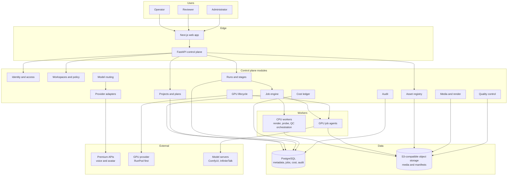
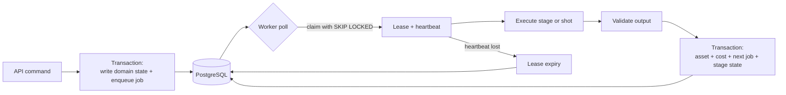
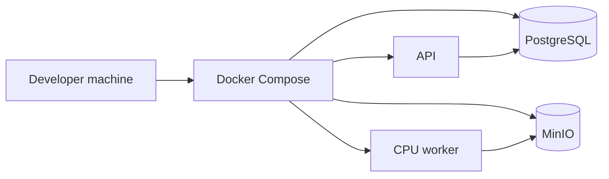
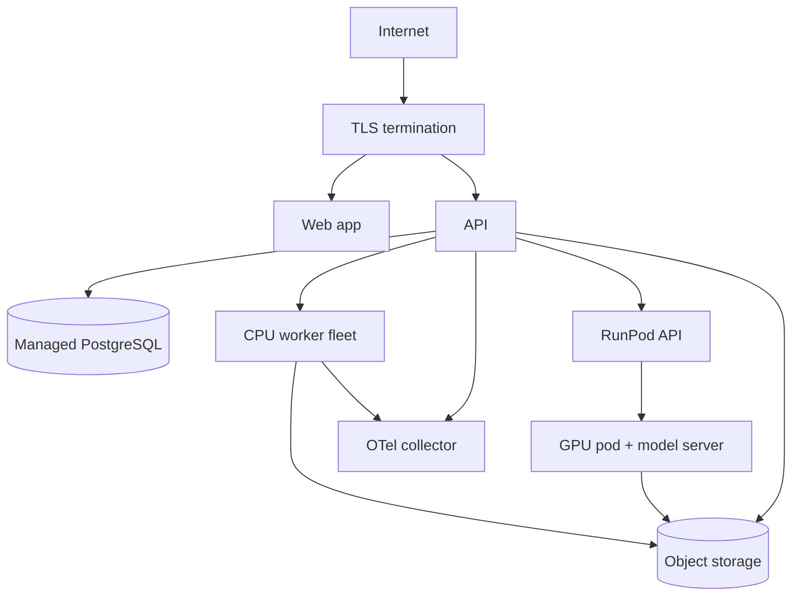

# System Architecture

| Field | Value |
|---|---|
| Status | Accepted for the foundation; implementation details provisional until Milestone 2 |
| Last updated | 2026-11-27 |
| Related | [ADR-001](decisions/ADR-001-architecture-style.md), [data flow](DATA_FLOW.md), [component design](COMPONENT_DESIGN.md), [job lifecycle](JOB_LIFECYCLE.md), [security boundaries](SECURITY_BOUNDARIES.md) |

## 1. Goals and drivers

The architecture is driven by the observed behaviour of the existing pipeline, not by a preference for a particular deployment fashion.

| Driver | Consequence |
|---|---|
| Long-running, expensive, failure-prone GPU work | Durable jobs, leases, checkpoints, idempotency, explicit GPU session lifecycle |
| Most GPU waste comes from model loading and setup | Resident model servers, compatible-job batching, preflight, idle shutdown |
| Quality depends on human judgement | First-class approval gates and versioned evidence, not a chat transcript |
| Models and providers will change | Capability-based routing, provider adapters, registry, licence gates |
| Costs must be attributable | Cost ledger keyed by run, stage, shot, provider and GPU session |
| Private footage and likeness | Explicit trust boundaries, deny-by-default egress, signed URLs, audit |
| Small initial team | Modular monolith and a single relational database before distributed systems |
| Future multi-tenant and private deployment | Tenant-aware schema and replaceable infrastructure from day one |

## 2. Architecture style

**A modular monolith control plane, independently scalable worker tiers, and replaceable external model servers.**

The control plane is one deployable application with enforced module boundaries. CPU workers and GPU agents run as separate processes and scale independently. Model servers are not embedded in the control plane; they are supplier-owned runtimes accessed through adapters.

### Why not microservices

A microservice fleet would add network partitions, distributed transactions, service discovery, per-service deployment and observability overhead before the team has measured throughput or team boundaries. The actual scaling pressure is GPU inference and rendering, which are already separate worker tiers. Module boundaries are enforced in code so that extraction remains possible when a concrete need appears.

See [ADR-001](decisions/ADR-001-architecture-style.md) for alternatives and consequences.

## 3. Control-plane modules

| Module | Responsibility | Owns |
|---|---|---|
| Identity and access | Authentication, sessions, roles, authorization checks | Users, sessions, role assignments |
| Workspaces and policy | Tenant boundary, provider egress policy, retention settings | Workspace, policy versions |
| Projects and plans | Projects, scripts, plate sheets, approvals, creative configuration | Project, ScriptVersion, PlateSheet, Plate, Approval |
| Asset registry | Asset identity, versions, provenance, storage locations, consent links | Asset, AssetVersion, Provenance |
| Runs and stages | Run snapshots, stage graph, gate state, cancellation | Run, StageRun, Gate |
| Job engine | Durable dispatch, leases, heartbeats, retries, dead-letter handling | Job, Attempt, Lease |
| Model routing | Capability resolution, quality floors, fallback policy, registry access | RoutingDecision, ModelVersion |
| Provider adapters | Translate domain commands to provider APIs; normalize errors and usage | ProviderCall, ProviderAccount |
| GPU lifecycle | Pool selection, provisioning, model residency, idle shutdown, reconciliation | GpuPool, GpuSession |
| Media and render | Probing, transcoding, composition, FFmpeg execution, manifests | RenderJob, MediaProbe |
| Quality control | Metric execution, threshold evaluation, evidence storage, gate decisions | QcReport, QcMetric |
| Cost ledger | Estimated and actual cost, budgets, attribution, reconciliation | CostEntry, Budget |
| Audit | Immutable record of sensitive actions | AuditEvent |

Cross-cutting concerns (configuration, logging, tracing, error taxonomy, idempotency keys) live in shared packages but must not become a hidden dependency cycle.

Module rules:

- A module exposes an application service interface and domain types. Other modules may not import its persistence models.
- Cross-module state changes happen through explicit service calls or domain events recorded in the same transaction as the state change.
- Provider SDK types never leak into domain modules.
- The web application talks only to the API; it never talks to PostgreSQL, object storage or provider APIs directly.

## 4. Worker tiers

| Tier | Runtime | Work | Scaling signal |
|---|---|---|---|
| API | FastAPI | Auth, CRUD, run commands, signed URL issuance, progress queries | Request latency and concurrency |
| CPU worker | Python | Preflight, probing, audio post-processing, QC metric orchestration, FFmpeg render, manifest assembly | Queue depth by job class |
| GPU agent | Python, colocated with model servers | Model server health, job execution, artifact upload, heartbeat | GPU pool queue and session utilization |
| Model server | ComfyUI / InfiniteTalk / future runtimes | Actual inference | GPU memory, step latency, queue depth |

CPU and GPU work are separate queues. A render backlog must not block inference dispatch, and a GPU outage must not stop QC of completed assets.

GPU agents are deliberately thin: they execute a declared job against a pinned model deployment, stream progress and upload outputs. They do not make routing decisions. This keeps provider-specific orchestration in the control plane and prevents a compromised or stale agent from selecting an unapproved model.

## 5. Data architecture

| Store | Content | Why |
|---|---|---|
| PostgreSQL | Metadata, run and job state, approvals, cost, audit, registry, policy | Transactions, constraints, durable queue with `SKIP LOCKED`, reporting |
| S3-compatible object storage | Source media, generated stills/video/audio, QC evidence, contact sheets, renders, manifests | Large immutable objects, signed access, lifecycle policies |
| Local NVMe on GPU hosts | Model weights, compilation caches, temporary inputs/outputs | Fast model loading; never the source of truth |
| Provider-side storage | Whatever a premium provider retains | Governed by contract and workspace policy; not assumed deletable |

Media is never stored in PostgreSQL. A database row stores the object key, content hash, MIME type, dimensions/duration, provenance and lifecycle state. The object store is private; access is through short-lived signed URLs issued after an authorization check.

Details: [ADR-004](decisions/ADR-004-storage.md), [asset lifecycle](ASSET_LIFECYCLE.md).

## 6. Job and orchestration model

The job engine uses PostgreSQL as the source of truth and as the initial queue. A worker claims a job with `SELECT ... FOR UPDATE SKIP LOCKED`, obtains a time-bounded lease, heartbeats while working, and commits the result and the next state transition in one transaction. Enqueueing a job in the same transaction as the domain change avoids the dual-write problem that plagues external brokers.

At higher throughput, a broker may be added for dispatch latency, but PostgreSQL remains the authority for job state. The queue is partitioned by job class and capability so that a slow render backlog cannot starve GPU dispatch.

Details: [ADR-002](decisions/ADR-002-async-orchestration.md), [job lifecycle](JOB_LIFECYCLE.md).

## 7. Model routing and provider abstraction

The application asks for a **capability**, not a model name: `voice.synthesize`, `image.keyframe`, `video.image_to_video`, `presenter.avatar`, `lipsync.generate`, `audio.music`, `qc.transcribe`.

A routing decision considers:

1. Workspace policy (allowed providers, data class, privacy).
2. Licence status (production-enabled only).
3. Capability and language support.
4. Quality floor for the profile.
5. Cost per accepted output and latency.
6. GPU availability and warm-pool state.
7. Fallback chain and whether a fallback preserves quality.

The decision and its reasons are stored with the run. A fallback that would cross a quality floor requires approval, not a silent substitution.

Details: [ADR-003](decisions/ADR-003-model-routing.md), [MODEL_ROUTING.md](../ai/MODEL_ROUTING.md), [PROVIDER_ABSTRACTION.md](../ai/PROVIDER_ABSTRACTION.md).

## 8. GPU architecture

GPU capacity is organized into **pools by capability and hardware requirement**, not by individual model:

| Pool class | Baseline hardware | Workload |
|---|---|---|
| `image.l40` | L40 48 GB | Qwen image generation and editing |
| `video.l40` | L40/L40S 48 GB | Wan image-to-video |
| `lipsync.a100` | A100 SXM 80 GB | Tested production InfiniteTalk configuration |
| `cpu.render` | CPU host | FFmpeg, HyperFrames, QC orchestration |

A pool session follows a lifecycle: provision, bootstrap, mount model cache, start model server, warm up, execute compatible jobs, idle, terminate. Model weights live on a persistent network volume or image layer to avoid the observed ~75 GB download per session. Idle shutdown targets 5–10 minutes, configurable per pool.

Hardware claims are provisional until reproduced. The founder's measurements include: InfiniteTalk 720p OOM on L40; L40 with DiT offloading ~190 s/step; L40 int8 ~300 s/step; A100 80 GB ~90 s/step in one configuration; InfiniteTalk 480p ~368–425 s per 4-second burst plus ~465 s model load. These are observations, not guarantees, and must be re-measured.

Details: [ADR-005](decisions/ADR-005-gpu-management.md), [GPU orchestration](../infrastructure/GPU_ORCHESTRATION.md).

## 9. Deployment topology

### 9.1 Development

GPU work is not required for most development. Provider adapters use recorded contract fixtures or a sandbox; live GPU tests are explicit and cost-capped.

### 9.2 Initial production

The control plane can run on one Linux host for the first deployment, with managed PostgreSQL and object storage where available. This is a deliberate cost and operational simplification, not an enterprise topology.

### 9.3 Enterprise/private (future)

- Kubernetes or a customer-approved container platform.
- Customer-managed PostgreSQL and object storage.
- Model servers inside the customer network; no media egress by default.
- SSO, SCIM, audit export, per-tenant encryption keys and retention controls.
- Optional dedicated GPU pools per tenant.

No enterprise certification is claimed in the MVP. See [DEPLOYMENT.md](../infrastructure/DEPLOYMENT.md).

## 10. Failure domains and degradation

| Failure | Expected behaviour |
|---|---|
| API instance dies | Load balancer routes to another stateless instance; in-flight requests fail cleanly |
| CPU worker dies | Lease expires; job becomes retryable; partial temp files are cleaned |
| GPU agent dies | Heartbeat stops; control plane marks session suspect; provider state is reconciled before replacement |
| GPU pod is preempted | Job attempt fails with a classified error; retry uses a new session; completed shots are reused |
| Model server hangs | Health check and step timeout fail the attempt; the session is terminated, not left running |
| PostgreSQL unavailable | No new dispatch; API returns a clear degraded state; workers stop claiming |
| Object storage unavailable | Preflight fails before GPU provisioning; no paid inference starts |
| Premium provider outage | Capability is marked degraded; fallback only if policy allows and quality floor is met |
| Cost budget exceeded | New GPU dispatch pauses; running work follows the configured stop policy |
| Clock skew | Leases use database time, not worker time |

The system prefers **fail visibly and cheaply** over retrying into a larger bill.

## 11. Scalability path

1. **Vertical/simple:** one API host, one CPU worker host, managed Postgres/S3, RunPod pools.
2. **Horizontal workers:** add CPU and GPU agents; partition queues by class; no schema change.
3. **Read scaling:** replicas for reporting; keep job claims on the primary.
4. **Queue pressure:** add a broker for dispatch while PostgreSQL remains authoritative; or partition job tables by time/class.
5. **Tenant scale:** workspace-aware indexes, per-tenant rate limits, optional schema/database isolation for enterprise.
6. **Regional:** separate control planes per region; media stays in-region; routing policy includes residency.

Each step requires measurements. No step is adopted because it is fashionable.

## 12. Explicit trade-offs

| Choice | Benefit | Cost |
|---|---|---|
| Modular monolith | Fast iteration, one transaction, simple deployment | Requires discipline to keep boundaries; one deploy unit for API modules |
| PostgreSQL queue | Durable, transactional, no extra broker | Polling latency; needs partitioning at high throughput |
| External model servers | Independent scaling and model pinning | Network hops, artifact transfer, session lifecycle complexity |
| Resident GPU pools | Avoids repeated model loading, the dominant observed waste | Idle cost if shutdown fails; requires watchdog and reconciliation |
| Premium APIs as baseline | Known quality for voice and presenter | Recurring cost, data egress, provider dependency |
| Open-weight models where measured | Lower marginal cost and privacy | Quality variance, GPU operations, licence review |
| S3-compatible storage | Durable, cheap, signed access | Eventually consistent behaviours must be handled; egress cost |

## 13. Assumptions

- The control plane runs on Linux containers; Windows and macOS are development clients only.
- PostgreSQL 16 or later and an S3-compatible API are available.
- The GPU provider exposes an API for pod lifecycle and cost, or can be reconciled from billing exports.
- Model servers can be pinned by image digest and model weight hash.
- The first deployment is single-region and single-tenant.
- The founder's existing scripts can be wrapped or ported incrementally; they do not need a full rewrite to be orchestrated.

## 14. Open architectural questions

- Exact throughput target for concurrent runs and shots; needed to size the queue and pools.
- Whether GPU agents can pull jobs directly or must be driven through a provider-specific control channel.
- Whether the first production deployment uses managed PostgreSQL or self-hosted.
- Whether model weights can be baked into images or must be mounted from a network volume for licensing reasons.
- Data residency and customer-managed inference requirements for enterprise.
- Whether the web application and API share a domain and session model or use a separate OIDC issuer.

Tracked in [OPEN_QUESTIONS.md](../project/OPEN_QUESTIONS.md).
