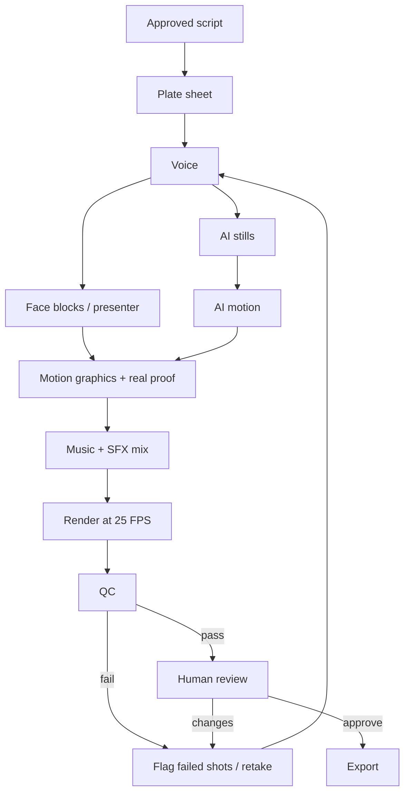

# Existing Workflow

| Field | Value |
|---|---|
| Status | Milestone 0 discovery; based on the founder's email and prior documentation |
| Last updated | 2026-11-28 |
| Related | [Workflow dependency graph](WORKFLOW_DEPENDENCY_GRAPH.md), [baseline reproduction plan](BASELINE_REPRODUCTION_PLAN.md), [unknown configurations](UNKNOWN_CONFIGURATIONS.md) |

## 1. Evidence basis

This reconstruction uses:

- the founder's five-page email, "Zenith video stack: how we build our videos (paid + open source + GPU), for you to replicate and improve";
- the foundation and Phase 2 documents in this repository;
- no direct inspection of the founder's scripts, workflows or media, because those materials have not yet been received.

Evidence labels:

| Label | Meaning |
|---|---|
| **Reported** | Stated by the founder as current practice or measured observation |
| **Inferred** | A reasonable reconstruction from reported facts; not confirmed |
| **Unknown** | Not stated; must be obtained or measured |

No configuration in this document should be treated as exact unless it is marked **Reported**. Unknowns are tracked in [UNKNOWN_CONFIGURATIONS.md](UNKNOWN_CONFIGURATIONS.md).

## 2. Current production pipeline (reported)

The founder describes the pipeline as:

> Approved script → Plate sheet → Voice → Face blocks → AI stills → AI motion → Motion graphics + real proof → Music + SFX mix → Render at 25 FPS → QC.

Two workflow profiles exist:

- **Explainer:** plates are timed using the actual voice track. Voice precedes visual timing.
- **Character/story:** visual approval happens first and voice generation happens later.

The target architecture adds explicit validation, still approval, composition and automated QC loop nodes. Those are target improvements, not necessarily current production behaviour.

## 3. Infrastructure (reported)

| Environment | Role |
|---|---|
| Mac M2, 16 GB | Editing, voice, quality control, motion-graphics rendering |
| Rented RunPod GPUs | Image generation, video generation, lip-sync models |
| Claude Code | Previously the controller: writes plate sheets, executes models, builds edits, uses skill files and individual Python tools |
| ComfyUI | Headless model orchestration, controlled through an API |

The Mac is not used for large model inference in the reported workflow. Heavy inference runs on rented GPUs.

## 4. Paid services (reported)

### 4.1 HeyGen Avatar 6

- Used for Avi's trained digital twin.
- Approximately **$0.089 per second** of generated face video.
- Avatar 6 is the established baseline.
- Avatar IV and Avatar V were rejected because of visual/mouth differences.
- Portrait and landscape twins exist.

### 4.2 ElevenLabs

- Professional voice clone on the team's account.
- Eleven v4.
- Approximately **one credit per character**.
- Backup Instant Clone exists.
- Current settings: stability **0.5**, similarity **0.75**, style **0**.
- Hindi and English words are written in Devanagari to reduce pronunciation drift.
- Numbers are written as words.

## 5. Open models and tools (reported)

| Area | Model / tool | Reported use |
|---|---|---|
| Image generation | Qwen-Image + Lightning 8-step LoRA | AI stills |
| Multi-reference image editing | Qwen-Image-Edit-2511 | Reference-based edits |
| Video generation | Wan 2.2 I2V A14B fp8 + LightX2V 4-step LoRA | AI motion from stills |
| Model orchestration | ComfyUI headless API | Executes image/video workflows |
| Lip-sync | InfiniteTalk on Wan 2.1 I2V 14B + LightX2V LoRA | Open lip-sync option |
| Rendering | HyperFrames, HTML, GSAP, Three.js, FFmpeg | Motion graphics and final render |
| Audio/QC | Whisper, SyncNet, MediaPipe, custom similarity scripts | Voice and lip-sync QC |

## 6. Stage-by-stage reconstruction

### Stage 0 — Approved script

| Field | Detail |
|---|---|
| Input | Human-approved script |
| Processing | Human approval; no model execution reported |
| Model/service | None |
| Configuration | Script format, language mix and length are **unknown** |
| Output | Approved script artifact |
| Dependencies | Founder/editor |
| Expected duration | Human-dependent |
| GPU | None |
| Cost | Human time |
| Quality checks | Human approval |
| Failure conditions | Script not approved; unresolved factual or pronunciation issues |
| Evidence | Reported |

### Stage 1 — Plate sheet

| Field | Detail |
|---|---|
| Input | Approved script |
| Processing | Generate a JSON plate sheet with one row per 2–6 second shot |
| Model/service | Claude Code with skill files (current); target is our own planner |
| Configuration | Row fields: layout, A-roll, B-roll, motion graphic, voiceover line, sound effects, caption; exact JSON schema **unknown** |
| Output | Plate sheet JSON |
| Dependencies | Stage 0; skill files; prompt templates |
| Expected duration | **Unknown**; human-in-the-loop |
| GPU | None |
| Cost | Coding-assistant usage, not a production inference cost |
| Quality checks | Human review of plates; exact validation rules **unknown** |
| Failure conditions | Missing fields, invalid durations, inconsistent visual plan, unapproved script facts |
| Evidence | Reported |

### Stage 2 — Voice

| Field | Detail |
|---|---|
| Input | Voiceover lines from the plate sheet |
| Processing | ElevenLabs synthesis, then pause squeeze, speed change and loudness normalisation |
| Model/service | ElevenLabs Eleven v4; professional clone; Instant Clone backup |
| Configuration | Stability 0.5, similarity 0.75, style 0; Devanagari for Hindi/English words; numbers as words; pauses > 0.3 s squeezed to ~0.2 s; speed 1.2x; loudness -14 LUFS |
| Output | Voice track or per-plate voice clips; exact storage shape **unknown** |
| Dependencies | Stage 1; voice clone; pronunciation preparation |
| Expected duration | **Unknown**; depends on character count and provider latency |
| GPU | None (provider-hosted) |
| Cost | ~1 credit per character |
| Quality checks | Speaker similarity ~0.96–0.97; Whisper CER ≤ 0.2; syllables per second; human listening |
| Failure conditions | Pronunciation drift, accent/register mismatch, provider rate limit, CER failure |
| Evidence | Reported |

### Stage 3 — Face blocks / presenter

| Field | Detail |
|---|---|
| Input | Voice audio and presenter script/segments |
| Processing | Generate presenter video from the trained avatar |
| Model/service | HeyGen Avatar 6 (baseline); InfiniteTalk as open alternative |
| Configuration | Avatar ID, portrait/landscape twin, resolution and segment boundaries **unknown** |
| Output | Presenter face video segments |
| Dependencies | Stage 2; avatar consent; segment plan |
| Expected duration | **Unknown**; provider-dependent |
| GPU | HeyGen-hosted; InfiniteTalk requires A100 80 GB for tested production config |
| Cost | ~$0.089 per second for HeyGen |
| Quality checks | Visual identity, mouth movement, lip-sync QC; human review |
| Failure conditions | Visual/mouth mismatch, avatar drift, provider outage, jaw over-stretch (InfiniteTalk) |
| Evidence | Reported |

### Stage 4 — AI stills

| Field | Detail |
|---|---|
| Input | Plate visual descriptions, references, character sheets |
| Processing | Generate stills; optionally edit with multi-reference models |
| Model/service | Qwen-Image + Lightning 8-step LoRA; Qwen-Image-Edit-2511 |
| Configuration | Exact workflow, sampler, steps, CFG, resolution, seed policy, LoRA versions **unknown** |
| Output | Still images per shot/candidate |
| Dependencies | Stage 1; references; ComfyUI workflow |
| Expected duration | **Unknown**; L40 48 GB reported for typical workload |
| GPU | L40 48 GB |
| Cost | GPU time; exact per-image cost **unknown** |
| Quality checks | Visual consistency, identity, artifacts, human approval |
| Failure conditions | Identity drift, artifacts, prompt mismatch, OOM, workflow error |
| Evidence | Reported |

### Stage 5 — AI motion

| Field | Detail |
|---|---|
| Input | Approved stills, motion prompt/intent, duration |
| Processing | Image-to-video generation |
| Model/service | Wan 2.2 I2V A14B fp8 + LightX2V 4-step LoRA |
| Configuration | Exact resolution, frame count, sampler, guidance, seed, LoRA version **unknown** |
| Output | Motion clips |
| Dependencies | Stage 4; approved stills |
| Expected duration | **Unknown**; depends on clip length and GPU |
| GPU | L40/L40S 48 GB |
| Cost | GPU time; exact per-clip cost **unknown** |
| Quality checks | Temporal consistency, no repeated-image zoom pulses, motion beat ≤ 2.4 s where possible, human review |
| Failure conditions | Flicker, identity drift, overlong beat, OOM, workflow error |
| Evidence | Reported |

### Stage 6 — Motion graphics + real proof

| Field | Detail |
|---|---|
| Input | Timeline, plate plan, real proof assets, copy |
| Processing | Compose editorial graphics, captions, proof visuals, stamps, logos, stickers |
| Model/service | HyperFrames, HTML, GSAP, Three.js; editorial design kit |
| Configuration | Exact project structure, fonts, textures, timing rules **unknown** |
| Output | Composition project and/or rendered graphics segments |
| Dependencies | Stages 3–5; brand assets; proof assets |
| Expected duration | **Unknown**; CPU/GPU for rendering |
| GPU | None reported for composition; render hardware **unknown** |
| Cost | Human/CPU time |
| Quality checks | One set/lighting/grade, light editorial palette, no dark AI look, visual relevance |
| Failure conditions | Missing proof assets, font/licence issues, timing drift, render errors |
| Evidence | Reported |

### Stage 7 — Music + SFX mix

| Field | Detail |
|---|---|
| Input | Voice track, music, SFX cues from plate sheet |
| Processing | Mix and master |
| Model/service | Procedural SFX scripts; music source **unknown** |
| Configuration | Loudness -14 LUFS; true peak -1 to -1.5 dB; exact sample rate **unknown** |
| Output | Mixed audio track |
| Dependencies | Stage 2; music/SFX assets |
| Expected duration | **Unknown** |
| GPU | None |
| Cost | Asset licensing or generation cost **unknown** |
| Quality checks | Loudness, true peak, sync, human listening |
| Failure conditions | Clipping, loudness miss, missing cue, unlicensed asset |
| Evidence | Reported |

### Stage 8 — Render at 25 FPS

| Field | Detail |
|---|---|
| Input | Timeline/composition, video segments, audio mix |
| Processing | Final render |
| Model/service | FFmpeg; HyperFrames output |
| Configuration | 25 FPS; resolution, codec, bitrate **unknown** |
| Output | Final video master |
| Dependencies | Stages 3–7 |
| Expected duration | **Unknown** |
| GPU | CPU render reported; exact hardware **unknown** |
| Cost | CPU time |
| Quality checks | Frame rate, duration, black/duplicate frames, audio |
| Failure conditions | Render failure, wrong FPS, audio drift, missing assets |
| Evidence | Reported |

### Stage 9 — QC and human review

| Field | Detail |
|---|---|
| Input | Voice, presenter, stills, motion, final render |
| Processing | Automated metrics, contact sheets, human review |
| Model/service | Whisper, SyncNet, MediaPipe, custom similarity scripts |
| Configuration | Similarity ~0.96–0.97; CER ≤ 0.2; mouth mean 0.28, P90 0.42, ~68% open; exact SyncNet threshold **unknown** |
| Output | QC reports, contact sheets, review decisions |
| Dependencies | All prior stages |
| Expected duration | **Unknown** |
| GPU | CPU/GPU depending on metric |
| Cost | Human and compute time |
| Quality checks | Metrics plus human judgement; metrics are screening gates |
| Failure conditions | Metric failure, accent mismatch not captured, jaw over-stretch, black/duplicate frames |
| Evidence | Reported |

## 7. GPU cost and loading observations (reported)

| Observation | Value |
|---|---|
| Pod setup | ~12 minutes |
| Model download | ~75 GB per session |
| 60-second short cost | ~$9.06 including setup and tests |
| Repeat in same style | ~$1 |
| InfiniteTalk 720p on L40 | Out of memory |
| L40 with DiT offloading | ~190 s/step |
| L40 int8 | ~300 s/step |
| A100 80 GB | ~90 s/step in one tested configuration |
| InfiniteTalk 480p production | ~368–425 s per 4-second burst, plus ~465 s model load |

These are observations, not vendor benchmarks. They must be reproduced.

## 8. Models tested and rejected (reported)

- IndicF5: high similarity but wrong accent/register; Latin script issues; one line per generation and Whisper retake loops.
- InfiniteTalk: best open lip-sync tested but did not match HeyGen; Hindi audio-encoder limitations; jaw over-stretch.
- LatentSync 1.6: faster but reduced mouth movement; did not preserve facial/head movement.
- LongCat-Video-Avatar 1.5: poor quality in tested configuration; 1.6 untested.
- Revideo: evaluated for editing; HyperFrames preferred.
- Chatterbox Multilingual: cancelled after IndicF5 failed.

## 9. What is not known

The largest unknowns are:

- exact ComfyUI workflow graphs and model files;
- exact plate sheet schema and prompt templates;
- exact voice, presenter, image, motion and lip-sync settings;
- exact HyperFrames project structure and render settings;
- exact QC implementations and thresholds;
- exact GPU setup scripts and model cache strategy;
- music and SFX sources and licences;
- actual timings and costs per stage in a clean run.

These are tracked in [UNKNOWN_CONFIGURATIONS.md](UNKNOWN_CONFIGURATIONS.md) and the materials checklist.

## 10. What must not be assumed

- That the reported settings are complete.
- That the existing scripts are standalone or runnable.
- That the models are commercially licensed.
- That the reported costs apply to a clean run.
- That the target architecture matches the current implementation.
- That any missing material can be reconstructed without the founder.
