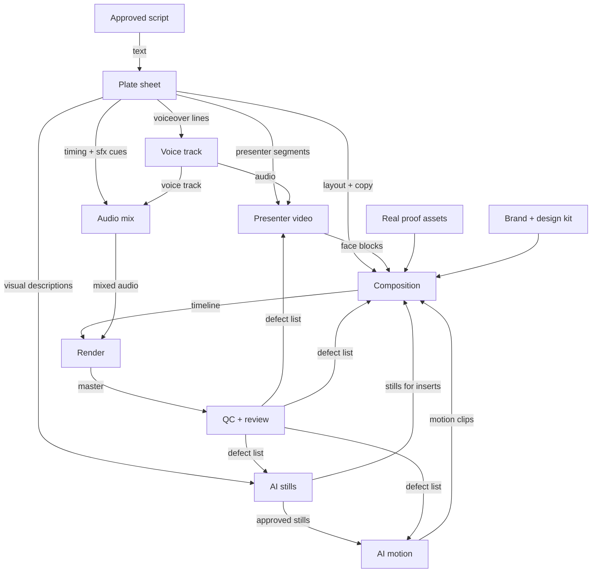
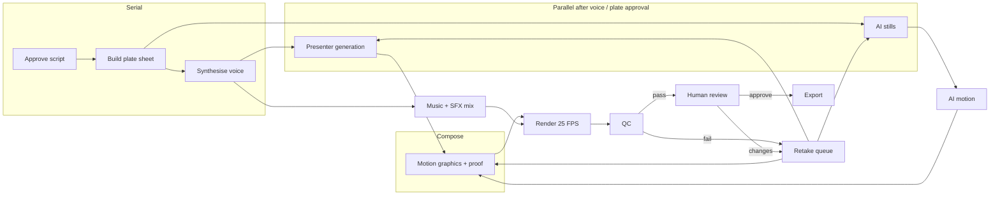
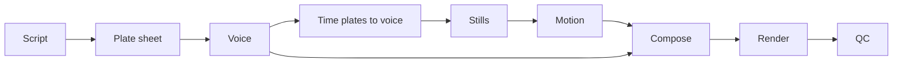
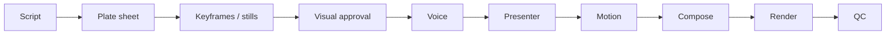

# Workflow Dependency Graph

| Field | Value |
|---|---|
| Status | Milestone 0 discovery; reconstruction from reported practice |
| Last updated | 2026-11-28 |
| Related | [Existing workflow](EXISTING_WORKFLOW.md), [baseline reproduction plan](BASELINE_REPRODUCTION_PLAN.md), [unknown configurations](UNKNOWN_CONFIGURATIONS.md), [architecture traceability](ARCHITECTURE_TRACEABILITY.md) |

## 1. Purpose

This document maps what depends on what in the founder's current workflow. It separates three different kinds of dependency that are easy to conflate:

- **Artifact dependency:** a stage consumes a file or record produced by another stage.
- **Execution dependency:** a stage cannot start until another stage has finished, even if it does not consume its output.
- **Resource dependency:** a stage needs a specific account, GPU class, licence or human decision.

The target architecture must preserve artifact dependencies, may relax execution dependencies through parallelism, and must make resource dependencies explicit rather than implicit.

Evidence labels follow [EXISTING_WORKFLOW.md](EXISTING_WORKFLOW.md): **Reported**, **Inferred**, **Unknown**.

## 2. Artifact graph



### 2.1 Artifact table

| Artifact | Produced by | Consumed by | Format | Versioned in target | Evidence |
|---|---|---|---|---|---|
| Approved script | Human | Plate sheet | Unknown (document or text) | Yes | Reported |
| Plate sheet | Planner (Claude Code today) | Voice, presenter, stills, motion, composition, audio mix | JSON, schema unknown | Yes | Reported |
| Voice track | Voice stage | Presenter, audio mix, QC | Audio; storage shape unknown | Yes | Reported |
| Presenter video | Presenter stage | Composition, QC | Video segments | Yes | Reported |
| AI stills | Image stage | Motion, composition, QC | Images | Yes | Reported |
| Motion clips | Motion stage | Composition, QC | Video clips | Yes | Reported |
| Real proof assets | Founder / client | Composition | Images, screen recordings, documents | Yes | Reported |
| Brand and design kit | Founder | Composition | Fonts, colours, textures, logos, stickers | Yes | Reported |
| Composition project | Composition stage | Render | HyperFrames/HTML project | Yes | Reported |
| Audio mix | Audio stage | Render, QC | Mixed audio | Yes | Reported |
| Video master | Render stage | QC, human review, export | 25 FPS video | Yes | Reported |
| QC report | QC stage | Human review, retake decisions | Metrics + contact sheets | Yes (as evidence) | Reported |

## 3. Execution graph



### 3.1 Stage dependency table

| Stage | Hard predecessors | Soft predecessors | Can run in parallel with | Blocking resource |
|---|---|---|---|---|
| Approved script | Human decision | Research, fact-check | — | Founder/editor |
| Plate sheet | Approved script | Brand kit, proof inventory | — | Planning model or human |
| Voice | Plate sheet voiceover lines | Pronunciation glossary | — | ElevenLabs account and clone |
| Presenter | Voice track; avatar selection | Plate sheet presenter segments | AI stills, AI motion for non-presenter shots | HeyGen account or GPU |
| AI stills | Plate sheet visual descriptions | Reference images | Presenter, voice post-processing | GPU or image provider |
| AI motion | Approved stills | Motion intent | Presenter, composition prep | GPU |
| Composition | Presenter, stills, motion, proof, brand kit | Captions | Audio mix | Editing machine |
| Audio mix | Voice, music, SFX assets | Plate sheet cues | Composition | Music/SFX licences |
| Render | Composition, audio mix | — | — | Render hardware |
| QC | Render, voice, presenter, stills, motion | — | — | QC models and human reviewer |
| Export | QC pass, human approval | — | — | Consent and platform spec |

## 4. Two workflow profiles

The dependency order differs by profile and the platform must model this explicitly.

### 4.1 Explainer profile



- Voice is generated before visual timing is final.
- Plate durations are derived from the voice track.
- Still and motion generation can begin once visual descriptions are stable, but final timing waits for voice.

### 4.2 Character/story profile



- Visual approval is a gate before voice and presenter spend.
- Changing a keyframe after voice generation can invalidate timing and presenter segments.

**Unknown:** whether the current implementation models these as separate code paths or as one pipeline with manual reordering. Tracked as U-021 in [UNKNOWN_CONFIGURATIONS.md](UNKNOWN_CONFIGURATIONS.md).

## 5. Critical path

The reported critical path for a 60-second short is:

```text
script approval -> plate sheet -> voice -> presenter (HeyGen) -> composition -> render -> QC -> human review
```

Inferred properties:

- **Presenter generation is the cost-critical path.** At ~$0.089 per second, a 60-second presenter segment costs about $5.34 before retries. Retakes multiply this.
- **GPU provisioning and model loading are the time-critical path for open models.** A ~12-minute pod setup and ~75 GB download dominate short jobs.
- **Voice is a schedule-critical path for the explainer profile**, because plate timing waits on it.
- **Composition and human review are the least predictable**, because they depend on proof availability and subjective approval.

These are **Inferred** from reported figures, not measured in a clean run.

## 6. Resource dependency inventory

| Resource | Used by | Failure impact | Current mitigation | Target treatment |
|---|---|---|---|---|
| ElevenLabs professional clone | Voice | No voice; blocked run | Instant Clone backup | Provider adapter + fallback |
| HeyGen Avatar 6 twin | Presenter | No presenter; open model fallback is lower quality | InfiniteTalk experiment | Capability route with quality floor |
| RunPod account and GPU quota | Stills, motion, lip-sync | No open-model inference | Manual pod setup | GPU pool abstraction |
| ComfyUI workflows | Stills, motion, lip-sync | Stages cannot run | Stored locally, format unknown | Versioned workflow packages |
| Claude Code and skill files | Plate sheet, orchestration | Planning and execution break | Human intervention | Owned planner and orchestrator |
| Mac M2 editing machine | Voice QC, composition, render | Delivery delay | None reported | CPU worker tier |
| Music and SFX licences | Audio mix | Export blocked or legal risk | Unknown | Licence registry and gate |
| Avatar consent | Presenter, export | Commercial export blocked | Unknown | Consent record and policy gate |
| Brand/proof assets | Composition | Generic or unverifiable video | Manual collection | Asset library with provenance |

## 7. Failure propagation

| Failure | Detected at | Propagates to | Recovery in current workflow | Target behaviour |
|---|---|---|---|---|
| Script fact error | Human review | Everything downstream | Rewrite and rerun | Approval gate before spend |
| Invalid plate duration | Voice or composition | Timing, motion, render | Manual edit | Schema and timing validation |
| Pronunciation drift | Voice QC | Presenter, captions, render | Regenerate line | Automatic retry with corrected text |
| Voice provider outage | Voice | Presenter, audio mix | Wait or use backup clone | Failover route, checkpoint |
| Avatar visual mismatch | Human review | Composition, render | Regenerate segment | Quality gate plus segment retry |
| Still identity drift | Human review | Motion, composition | Regenerate still | Identity score and retry |
| Motion flicker or pulse | Human review | Composition | Regenerate clip | Temporal QC and retry |
| GPU OOM | Inference | Stage | Change resolution or hardware | Preflight and route to larger GPU |
| Model download failure | Pod setup | All GPU stages | Retry download | Cached images and volumes |
| Missing proof asset | Composition | Render, approval | Manual collection | Early asset completeness check |
| Loudness miss | QC | Export | Remix | Deterministic mastering gate |
| Lip-sync failure | QC | Export | Retake | SyncNet gate plus human review |
| Consent missing | Export | Publication | Manual check | Hard export block |

## 8. Parallelism opportunities

Reported or inferred opportunities, in order of expected value:

1. **Presenter generation and non-presenter stills** can run concurrently after the plate sheet and voice are stable.
2. **Per-shot image and motion jobs** can fan out across GPU workers, subject to identity consistency.
3. **Audio mixing** can run while composition is being assembled, provided cue timings are stable.
4. **QC metrics** can run per artifact as it is produced, not only on the final render.
5. **Retakes** should be scoped to affected shots rather than rerunning the whole video.

The current workflow's actual parallelism is **Unknown**. The founder describes a sequential pipeline; whether Claude Code ran stages concurrently is not stated.

## 9. Dependency rules for the target system

These rules follow from the graph and must be encoded as invariants, not conventions:

- No voice generation without an approved, validated plate sheet version.
- No presenter generation without a voice artifact whose content hash matches the plate sheet version.
- No motion generation without an approved still for that shot.
- No composition against an unapproved or superseded artifact version.
- No render without a complete audio mix and all required visual segments.
- No export without QC pass and human approval.
- Any artifact replacement invalidates downstream artifacts and QC evidence derived from it.

## 10. Unknowns affecting the graph

| ID | Unknown | Graph impact |
|---|---|---|
| U-001 | Exact plate sheet schema and required fields | Artifact edges and validation rules |
| U-002 | Whether voice is one track or per-plate clips | Fan-out and retake granularity |
| U-003 | Whether presenter segments are per plate or per block | Parallelism and cost |
| U-004 | Whether stills are approved before motion in all profiles | Execution order |
| U-005 | Actual concurrency used by the current controller | Parallelism assumptions |
| U-006 | Whether music is licensed, generated or reused | Resource dependency and export legality |
| U-007 | Whether QC runs per artifact or only on the master | Feedback loop latency |
| U-008 | Whether the founder manually reorders stages per project | Profile modelling |

All are expanded in [UNKNOWN_CONFIGURATIONS.md](UNKNOWN_CONFIGURATIONS.md).
