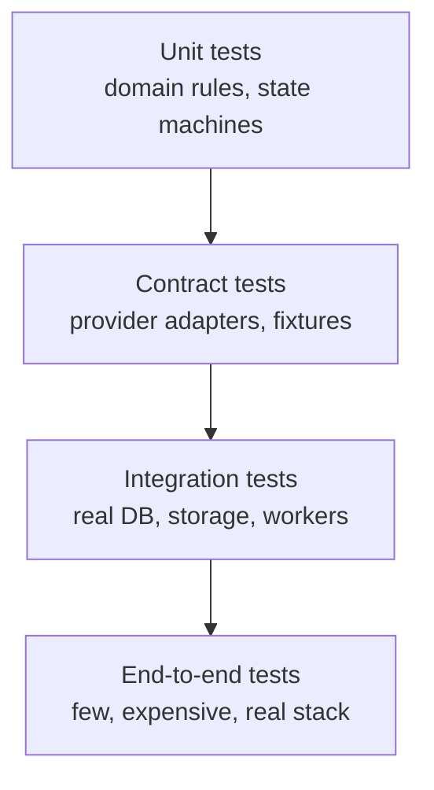

# Testing Strategy

| Field | Value |
|---|---|
| Status | Foundation |
| Last updated | 2026-11-27 |
| Related | [Acceptance criteria](../product/ACCEPTANCE_CRITERIA.md), [error handling](ERROR_HANDLING.md), [observability](OBSERVABILITY.md) |

## 1. Principles

- Tests exist to protect behaviour and evidence, not to increase coverage numbers.
- Domain rules are tested without a database or network.
- Persistence, queue and provider behaviour are tested against real dependencies, not mocks that can drift.
- A passing test is not proof of production quality; quality criteria require real media and human review.
- Fixtures are labelled synthetic, approved or production-derived, and are never committed as private media.
- Live provider and GPU tests are explicit, cost-capped and never run in routine CI.

## 2. Test pyramid

The pyramid is weighted toward unit and integration tests. End-to-end tests are reserved for critical paths and release gates.

## 3. Unit tests

Scope:

- State machine transitions for jobs, runs, stages, assets and approvals.
- Domain invariants and validation rules.
- Plate timing and frame rounding.
- Cost calculation and budget reservation.
- Routing decisions with a fake registry.
- Idempotency key derivation.
- Error classification.

Characteristics:

- Fast, deterministic, no I/O.
- No database, network or filesystem beyond temporary files.
- One assertion per behaviour where practical.
- Golden expected values are reviewed, not auto-accepted.

## 4. Integration tests

Scope:

- Repository implementations against real PostgreSQL.
- Job claiming, leasing, heartbeat and reclamation.
- Asset upload, hash verification and signed URL issuance.
- Queue partitioning and retry behaviour.
- Run creation and stage materialisation.
- Cost ledger writes and budget reservations.

Characteristics:

- Use Testcontainers or a local PostgreSQL instance.
- Each test uses an isolated schema or database.
- Tests clean up after themselves.
- No live provider calls.

Object storage integration uses MinIO or Testcontainers to exercise the real S3 API, including multipart uploads and signed URLs.

## 5. Contract tests for providers

Every provider adapter must have:

- Recorded HTTP fixtures that exercise success, validation failure, rate limit, timeout and server error.
- A documented live smoke test that can be run manually with a cost cap.
- Schema validation of provider responses.
- Normalisation tests for usage and cost.
- Idempotency behaviour tests where supported.

Recorded fixtures must be labelled with the provider API version and date. They are not a substitute for a live smoke test before production enablement.

## 6. End-to-end tests

Scope:

- Create project, plan, voice, keyframe, motion, render and export using synthetic media and a stubbed GPU provider.
- Shot-level regeneration.
- Failure and retry of a stage.
- Approval gates and export blocking.
- Cost report generation.

Characteristics:

- Run against a deployed local stack.
- Use synthetic or approved media only.
- No claim of production quality.
- Run in CI on a schedule or before release, not on every commit if too slow.

## 7. Quality testing

Quality cannot be fully automated, but parts can be measured.

Automated checks:

- Voice similarity, Whisper CER and syllables per second.
- SyncNet and MediaPipe mouth-opening metrics.
- Black-frame and duplicate-frame detection.
- Loudness and true peak.
- Frame rate and duration.
- Caption sync and presence.

Human checks:

- Accent and register match.
- Visual consistency and identity.
- Editorial quality and pacing.
- Lip-sync naturalness, including jaw over-stretch.

Quality tests store raw values and the threshold configuration used. A metric pass does not override a human rejection.

## 8. GPU and infrastructure tests

- GPU lifecycle is tested against a fake provider that can simulate slow provisioning, preemption, hung health checks and orphaned sessions.
- Idle shutdown is tested with a clock-controlled harness.
- Budget pause is tested with concurrent dispatch.
- One live GPU smoke test is required before enabling a new pool or model server in production.
- Cost reconciliation is tested against a sample billing export.

## 9. Security tests

- Secret scan in CI.
- Dependency vulnerability scan.
- Authorization tests at the repository/service boundary for cross-workspace access.
- Signed URL access tests with unauthenticated and unauthorized requests.
- Provider egress policy tests.
- Deletion tests verifying media and derivatives are removed while audit records remain.

## 10. Performance and reliability tests

- Queue throughput and latency under load.
- Lease reclamation under worker failure.
- Render duration and memory usage for representative timelines.
- Model loading time and warm-up latency.
- GPU utilization and idle time.

Performance tests are run with documented hardware and model versions. Results are not generalized beyond the tested configuration.

## 11. Regression tests

- Every bug fix includes a regression test.
- Quality regressions are tracked with stored manifests and evidence.
- Model or provider changes require a re-run of the reference reproduction or a documented, justified subset.

## 12. Test data and fixtures

- Fixtures are stored under `tests/fixtures/` or `tests/golden/`.
- Each fixture records its source, licence and whether it is synthetic, approved or production-derived.
- Private footage and voice samples are never committed; tests that need them run in a controlled environment and are not part of routine CI.
- Golden files have a documented regeneration command and require review when updated.

## 13. CI pipeline (planned)

1. Lint and type check.
2. Unit tests.
3. Integration tests with Testcontainers.
4. Contract tests with recorded fixtures.
5. Secret and dependency scan.
6. Build containers.
7. End-to-end tests on a schedule or release branch.

Live provider and GPU tests are manual workflows with cost caps and explicit approval.

## 14. Definition of done for tests

A change is not tested unless:

- The relevant unit and integration tests pass on the changed code.
- New behaviour has new tests.
- Flaky tests are fixed or quarantined with a tracked issue, not ignored.
- Test output is recorded in the pull request or milestone report.
- Quality claims are backed by stored evidence, not by "tests passed".

## 15. Open questions

- Whether frontend E2E tests run in CI or only before release.
- Whether to adopt property-based testing for domain invariants.
- How to manage large golden files.
- Whether to use a separate test database per developer or shared local instance.

Tracked in [OPEN_QUESTIONS.md](../project/OPEN_QUESTIONS.md).
