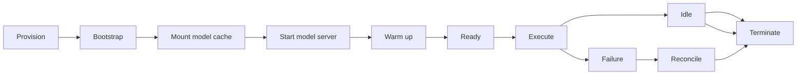

# GPU Orchestration

| Field | Value |
|---|---|
| Status | Foundation; operational details provisional until reproduction |
| Last updated | 2026-11-27 |
| Related | [ADR-005](../architecture/decisions/ADR-005-gpu-management.md), [cost optimization](COST_OPTIMIZATION.md), [job lifecycle](../architecture/JOB_LIFECYCLE.md), [security boundaries](../architecture/SECURITY_BOUNDARIES.md) |

## 1. Purpose

GPU orchestration exists to turn expensive, slow, failure-prone inference into a managed, measurable and recoverable resource. The dominant observed waste is model loading and provisioning, not inference. The design therefore prioritises residency, batching, preflight and reliable teardown.

## 2. Pool model

A pool is defined by capability and hardware requirement, not by model:

| Pool | Baseline hardware | Capability | Notes |
|---|---|---|---|
| `image.l40` | L40 48 GB | `image.keyframe`, `image.edit` | Qwen workloads |
| `video.l40` | L40/L40S 48 GB | `video.image_to_video` | Wan workloads |
| `lipsync.a100` | A100 SXM 80 GB | `lipsync.generate` | Tested InfiniteTalk configuration |
| `cpu.render` | CPU host | Render, QC, audio | Not a GPU pool |

Pool configuration includes:

- provider and region
- minimum and maximum sessions
- idle shutdown window
- hard session maximum
- model cache volume or image
- concurrency policy
- cost limits
- health check thresholds

## 3. Session lifecycle

### 3.1 Provision

- Create the pod or instance through the provider API.
- Attach network, storage and secrets.
- Record provider session ID and cost start time.

### 3.2 Bootstrap

- Pull or verify the runtime image.
- Install or verify dependencies.
- Mount the model cache.

### 3.3 Model cache

- Model weights live on a persistent volume or in the image.
- Downloading ~75 GB per session is treated as an incident.
- Cache integrity is verified by hash before the model server starts.
- Cache updates are versioned and auditable.

### 3.4 Start and warm up

- Start the model server.
- Wait for health check.
- Run a representative warm-up request.
- Record model load and warm-up timings.

### 3.5 Execute

- Claim a job from the control plane.
- Validate inputs and routing.
- Run inference.
- Upload outputs to staging storage.
- Validate outputs.
- Complete the job and record cost.

### 3.6 Idle and terminate

- After the last job, start the idle timer.
- Shut down after the configured window (baseline 5–10 minutes).
- Terminate the pod and verify provider state.
- Record teardown timing and final cost.

## 4. Preflight

Preflight runs on CPU before any GPU provisioning:

1. Validate input assets and hashes.
2. Validate plate and timing constraints.
3. Resolve routing and licence status.
4. Check provider connectivity and egress policy.
5. Check budget headroom.
6. Check pool availability and model server health.
7. Reserve budget.

Preflight failure is cheap. It prevents expensive failures and keeps GPU sessions focused on inference.

## 5. Batching and residency

- A warm session executes multiple compatible jobs.
- Compatibility is defined by pool, model deployment and resource requirements.
- Batching reduces per-job setup cost.
- A session is leased to one job at a time unless the model server explicitly supports concurrency.
- Model residency is measured by load time and warm-up time.

## 6. Idle shutdown and watchdog

- Idle shutdown is configured per pool.
- The watchdog runs independently of the job that created the session.
- It detects sessions with no active lease past the idle window.
- It attempts graceful termination and records the result.
- If termination fails, an administrator is paged with the provider session ID.
- Orphaned sessions are attributed to the originating run as waste.

## 7. Reconciliation

- Before provisioning a replacement session, the system reconciles provider state.
- A session that appears lost may still be running and billing.
- Reconciliation checks provider status, cost and last heartbeat.
- A session is only declared lost after reconciliation fails or times out.

## 8. Cost metering

Every session records:

- provision start and end
- bootstrap duration
- model load duration
- warm-up duration and cost
- per-job inference and upload durations
- idle duration
- teardown duration
- provider cost
- attributed run, stage and shot

Cost is attributed to jobs and runs. Waste is visible, not smoothed away.

## 9. Security

- GPU pods are treated as hostile execution environments.
- They have no database or secret-store access.
- Inputs are fetched through scoped, short-lived credentials.
- Outputs are uploaded to staging and validated before promotion.
- Model images and weights are pinned by digest and hash.
- Outbound network access is restricted to approved endpoints.

See [SECURITY_BOUNDARIES.md](../architecture/SECURITY_BOUNDARIES.md).

## 10. Observability

GPU metrics are defined in [OBSERVABILITY.md](../engineering/OBSERVABILITY.md). At minimum:

- sessions created, terminated, orphaned
- provisioning, load, warm-up, inference, upload, idle, teardown durations
- utilization and memory
- queue depth and wait time
- cost per session and per accepted output

## 11. Measured baseline and targets

Founder's measured observations (must be reproduced):

- Pod setup ~12 minutes.
- ~75 GB model download.
- 60-second short ~$9.06 including setup and tests.
- Repeat in same style ~$1.
- InfiniteTalk 480p ~368–425 s per 4-second burst + ~465 s model load.
- InfiniteTalk 720p OOM on L40.
- L40 with DiT offloading ~190 s/step.
- L40 int8 ~300 s/step.
- A100 80 GB ~90 s/step in one tested configuration.

Targets (to be validated):

- Reduce setup and loading waste per accepted output.
- No orphaned sessions.
- No GPU session exceeds its idle window during a normal run.
- Cost per accepted output is measurable and compared with the baseline.

No specific percentage reduction is promised before measurement.

## 12. Open questions

- Whether GPU agents pull jobs or are driven by a control channel.
- Whether model weights can be baked into images for all providers.
- Whether serverless GPU is viable for burst capacity.
- Whether per-tenant GPU pools are required for enterprise.
- How to verify termination when provider APIs are inconsistent.

Tracked in [OPEN_QUESTIONS.md](../project/OPEN_QUESTIONS.md).
