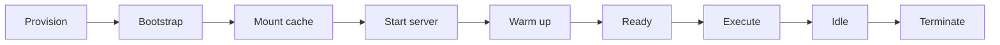

# GPU Provider Strategy

| Field | Value |
|---|---|
| Status | Foundation; no GPU provisioned |
| Last updated | 2026-11-27 |
| Related | [GPU orchestration](GPU_ORCHESTRATION.md), [cost optimization](COST_OPTIMIZATION.md), [ADR-005](../architecture/decisions/ADR-005-gpu-management.md) |

## 1. Provider choice

RunPod is the initial GPU provider because it is the provider already used in the founder's workflow and supports the required GPU types. The application must not depend on RunPod-specific concepts; all provider interactions go through a `GpuPoolPort`.

## 2. Abstraction layer

The GPU abstraction exposes:

- `provision(pool, requirements) -> session`
- `status(session) -> SessionStatus`
- `terminate(session) -> void`
- `reconcile(session) -> SessionStatus`
- `price(pool, duration) -> cost`

The control plane uses these methods. Provider-specific details live only in the adapter.

## 3. Provisioning

- Pools are defined by capability and hardware requirement.
- A session is provisioned only after preflight passes.
- Provisioning records provider session ID, start time and cost.
- A provisioning failure is classified and retried according to policy.

## 4. Model downloads and persistent storage

- Model weights are cached on a persistent volume or baked into the image.
- Downloading ~75 GB per session is treated as an incident.
- Cache integrity is verified by hash.
- Cache updates are versioned and auditable.

## 5. Model residency

- Model servers stay warm across compatible jobs.
- Warm-up runs a representative request and records latency.
- Residency is measured by load time and warm-up time.
- A cold start is recorded as a cost and latency penalty.

## 6. Worker lifecycle

## 7. Queue scheduling

- Jobs are partitioned by class and capability.
- A warm session executes compatible jobs.
- Scheduling considers pool availability, model residency and budget.
- A slow render backlog must not starve GPU dispatch.

## 8. VRAM-aware task placement

- Tasks declare their VRAM requirement.
- The scheduler places a task only on a session with sufficient free VRAM.
- OOM is classified as a GPU failure and may retry on a larger pool if policy allows.
- Hardware claims are provisional until reproduced.

## 9. Idle shutdown

- Idle shutdown targets 5–10 minutes, configurable per pool.
- The watchdog runs independently of the job that created the session.
- Termination is verified against provider state.
- Orphaned sessions are attributed as waste.

## 10. Retry behaviour

- Transient failures retry with backoff.
- Preemption creates a new session; completed shots are reused.
- Attempt limits are enforced.
- Retries do not repeat completed paid work.

## 11. Job cancellation

- Cancellation stops new dispatch.
- In-flight jobs reach a safe checkpoint or are terminated at hard timeout.
- Owned GPU sessions are terminated.
- Cancellation does not erase cost entries.

## 12. Utilisation tracking

Track per session and pool:

- provisioning, load, warm-up, inference, upload, idle and teardown durations
- GPU utilization and memory
- queue depth and wait time
- cost per session and per accepted output

## 13. Cost per task and per accepted video

- Every session and job records estimated and actual cost.
- Cost per accepted output includes failures and retries.
- Waste is visible in dashboards and manifests.
- Budget thresholds pause dispatch.

## 14. Future providers

The adapter boundary allows adding providers without changing domain code. Candidate providers can be evaluated on:

- GPU availability and types
- pricing and billing granularity
- storage and egress costs
- API reliability
- termination reliability
- data residency and compliance

No provider is added without a cost and reliability comparison.

## 15. Open questions

- Whether serverless GPU is viable for burst capacity.
- Whether per-tenant pools are required for enterprise.
- How to verify termination when provider APIs are inconsistent.
- Whether to use spot or preemptible instances.

Tracked in `docs/project/OPEN_QUESTIONS.md`.
