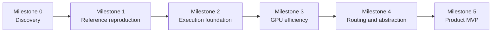

# MVP Scope

| Field | Value |
|---|---|
| Status | Provisional until Milestone 0 audit completes |
| Last updated | 2026-11-27 |
| Related | [PRD](PRD.md), [acceptance criteria](ACCEPTANCE_CRITERIA.md), [milestones](../project/MILESTONES.md) |

## 1. Definition

The MVP is the first version that can run a real 60-second short end to end for the founder's studio, with human approval gates, shot-level regeneration, cost visibility and no dependency on a coding assistant.

It is **not** the first milestone. Milestone 1 reproduces the existing output through a controlled reference run; Milestone 5 packages that capability into a usable product. The MVP is therefore the first **sellable** scope, not the first technical proof.

## 2. Target user and deployment

- One workspace owned by the founder's studio.
- One operator role, one reviewer role, one administrator role. A user may hold more than one role.
- Local accounts with strong password hashing; OIDC is optional and may be deferred.
- Single-region deployment on a Linux host for the control plane, PostgreSQL and S3-compatible storage.
- GPU inference through a provider adapter (RunPod first), with model servers outside the control-plane host.
- No public self-service sign-up, no billing, no external customer tenancy.

The data model is tenant-aware from the start (a workspace identifier on owned records), but multi-tenant isolation is not certified in the MVP. This avoids a schema rewrite without pretending enterprise readiness.

## 3. P0 capabilities

P0 means the MVP cannot ship without it.

### 3.1 Project and planning

- Create a project with format, aspect ratio, language mix and workflow profile.
- Import or author a script as an immutable version.
- Generate a structured plate sheet with one row per 2–6 second shot and the fields defined in the PRD.
- Edit plates in a structured form; validate required fields and timing bounds.
- Approve a plate-sheet version with attribution; approval freezes it for the run.
- Snapshot configuration, script, plate sheet and code revision at run creation.

### 3.2 Execution

- Durable run and job records with queued, running, waiting-for-approval, failed, cancelled and succeeded states.
- Stage-level retry from the last valid checkpoint.
- GPU session lifecycle management with preflight validation, model residency, idle shutdown and cost capture.
- Provider adapters for the baseline voice, image, motion, presenter and lip-sync capabilities.
- Idempotency for paid calls where supported; reconciliation before retry where not.
- Cancellation that stops new work and terminates owned GPU sessions.

### 3.3 Creative pipeline

- Voice generation with the baseline pronunciation and post-processing rules.
- Voice QC with similarity, Whisper CER and syllables per second.
- Keyframe generation from approved plate descriptions.
- Keyframe approval gate for the character/story profile.
- Image-to-video motion from approved stills, with motion-beat limits.
- Presenter generation through the premium baseline; open lip-sync selectable where evaluated.
- Lip-sync QC with SyncNet and MediaPipe evidence.
- Editorial graphics composition and 25 FPS FFmpeg render.
- Music/SFX mix with recorded licences.
- Final audio at approximately -14 LUFS and true peak -1 to -1.5 dB.

### 3.4 Review and regeneration

- Stage progress with elapsed time, current job and blocking reason.
- Approve/reject/request-changes actions with comments.
- At most two scored candidates per shot.
- Shot-level regeneration that preserves the rest of the timeline and creates new versions.
- Contact sheets and QC evidence visible to the reviewer.
- Export blocked while required gates are open.

### 3.5 Export and reporting

- Export video, captions/subtitles, thumbnail candidates and a run manifest.
- Run manifest includes model versions, provider, settings hash, input versions, hardware, timings and cost.
- Cost report by run, stage, shot and provider.
- Audit trail for approvals, exports, credential changes and configuration changes.

## 4. P1 capabilities

P1 is valuable but may ship shortly after the first MVP release if the P0 path is stable.

- Side-by-side candidate comparison with playback synchronisation.
- Reusable project templates and saved creative presets.
- Basic usage quotas and budget alerts (P0 includes cost capture, not full quota enforcement).
- Reviewer comments anchored to a timestamp in a shot.
- Bulk retry of failed shots.
- Webhook or email notification when a run needs review.
- Export presets for multiple aspect ratios from the same master timeline.

## 5. Explicitly deferred

| Capability | Why deferred |
|---|---|
| Public sign-up, plans, invoices | Requires billing, abuse handling and support operations |
| Multi-tenant isolation certification | Security and data-residency work; schema is prepared but not certified |
| Enterprise SSO/SCIM | Needs an identity provider contract and admin UX |
| Automatic social publishing | Platform APIs, review policy and failure handling are separate products |
| Model fine-tuning and custom LoRAs | Research track; must not block reproduction |
| Open-weight voice replacement | ElevenLabs remains the quality baseline; IndicF5 failed accent/register evaluation |
| Replacing HeyGen with open lip-sync as a requirement | InfiniteTalk did not match HeyGen in tested conditions |
| Real-time collaboration | Not needed for a studio of this size |
| Mobile app | Desktop review is sufficient |
| Marketplace / third-party model onboarding | Needs licensing, sandboxing and revenue model |
| Full financial accounting | Cost ledger is operational, not a book of record |

## 6. Quality bar

The MVP must not lower the existing creative standard to ship faster.

- A reference 60-second short is reproduced and accepted by the founder in a blind comparison.
- Voice and presenter quality use the established premium baselines unless an open alternative passes the same gates.
- Every motion clip starts from an approved still.
- The 2.4-second motion-beat guidance is enforced as a warning or block according to the profile.
- One set, lighting direction and grade per video.
- No repeated stills with artificial zoom pulses.
- QC evidence is stored, not just displayed.
- A human can override a blocking QC gate only with a recorded reason and role permission.

## 7. Operational bar

- A failed worker is detected within one heartbeat interval; its lease expires and the job becomes retryable.
- GPU sessions are terminated after the configured idle window; orphan detection runs independently of the job that created the session.
- A run cannot be marked succeeded if any required artifact is missing or any blocking gate is open.
- Cost entries exist for every provider call and GPU session, including failed attempts where the provider charges.
- Logs, metrics and traces carry run and stage correlation identifiers.
- Backup and restore of PostgreSQL and object storage is documented and tested at least once before release.

## 8. Security and privacy bar

- No secrets in the frontend bundle, Git history or logs.
- Media access through short-lived signed URLs; bucket is private.
- External provider egress deny-by-default per workspace.
- Consent records for voice and likeness linked to the assets used.
- Deletion removes media and derived artifacts; audit records follow the retention policy.
- Dependency and model licences reviewed before inclusion.

## 9. What the MVP is not

- It is not a general-purpose video editor.
- It is not a model-hosting platform.
- It is not a promise that every model in the registry is production-ready.
- It is not a claim that open-weight models have reached parity with premium providers.
- It is not a multi-tenant SaaS.

## 10. Release gates

The MVP ships only when:

1. [ ] The reference reproduction is accepted and its evidence is recorded in the run manifest.
2. [ ] All P0 capabilities have passing acceptance tests.
3. [ ] Blocking QC gates and approval gates cannot be bypassed without an audited override.
4. [ ] Shot-level regeneration is demonstrated on a real run.
5. [ ] A failed GPU session is recovered without duplicating paid work.
6. [ ] Cost per accepted output is reported for the reference run.
7. [ ] Security review covers secrets, signed URLs, provider egress, authz and audit.
8. [ ] Backup/restore and deletion workflows are exercised.
9. [ ] The open questions that block release are closed or explicitly accepted.
10. [ ] Documentation matches the shipped behaviour.

## 11. Sizing and sequencing

No calendar estimate is committed before the code audit. The dependency order is:

Attempting to compress M0 and M1 is the largest schedule risk: without the existing scripts and a measured reference, the team cannot distinguish a product regression from a model regression. See [RISKS.md](../project/RISKS.md).
