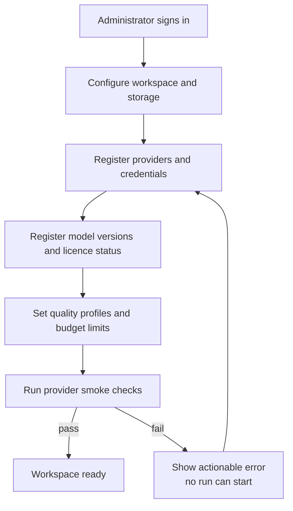
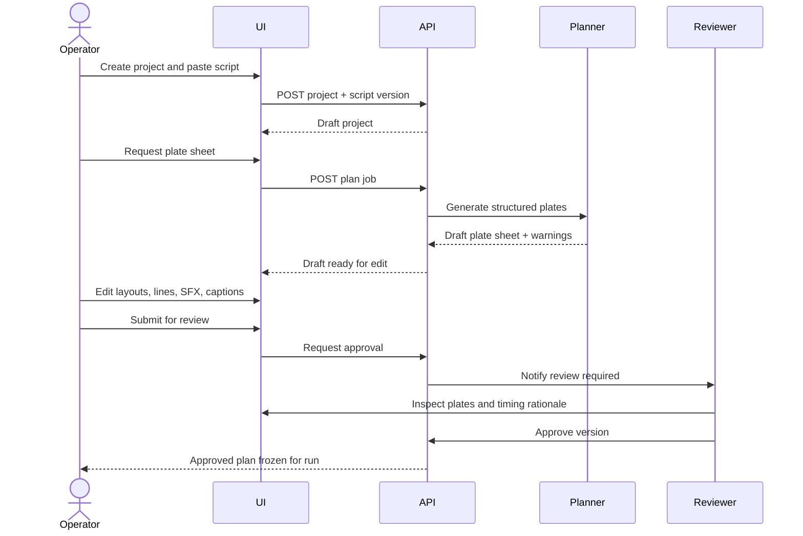
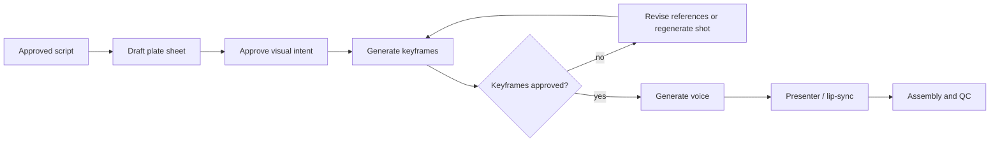
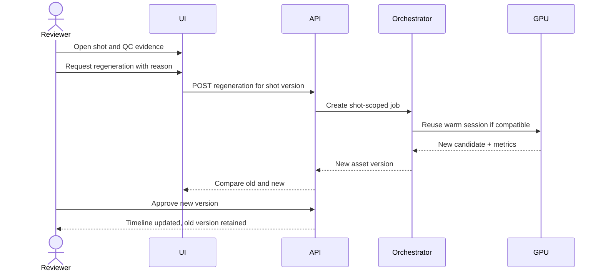
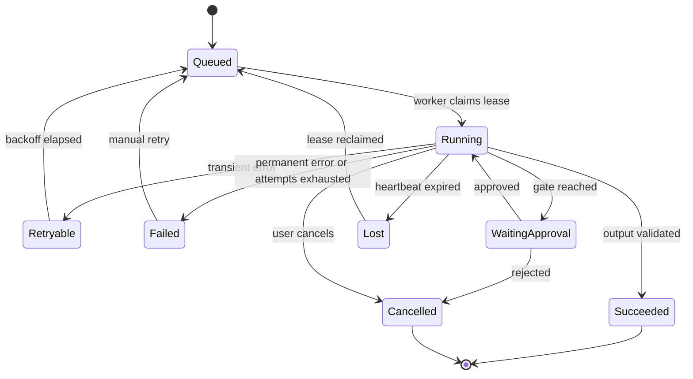

# User Flows

| Field | Value |
|---|---|
| Status | Foundation; reflects intended MVP behaviour |
| Last updated | 2026-11-27 |
| Related | [PRD](PRD.md), [MVP scope](MVP_SCOPE.md), [job lifecycle](../architecture/JOB_LIFECYCLE.md) |

Flows describe intended behaviour, not implemented behaviour. Where a flow depends on an unresolved decision, the dependency is named.

## 1. Roles

| Role | Capabilities |
|---|---|
| Operator | Create projects, generate plans, run stages, regenerate shots, request review |
| Reviewer | Inspect evidence, compare scored candidates, approve/reject, record override reasons |
| Administrator | Manage providers, credentials, models, budgets, users and audit |
| System | Execute jobs, enforce gates, record provenance and cost, terminate idle GPUs |

The founder may hold all three roles initially. Role checks are server-side; hiding a button is not authorization.

## 2. First-run setup

**Goal:** make the workspace capable of a real run without editing code.

Preconditions: control plane, database and object storage are running; the administrator has a secret-manager path for credentials.

Postconditions: providers have verified connectivity, models have a licence decision and quality status, and a synthetic smoke run has produced a non-exportable test artifact.

Failure handling: a failed smoke check blocks only the affected capability, not the whole workspace. The UI must say which capability is unavailable and why.

## 3. Create a project and approve the plan (explainer profile)

**Goal:** turn an approved script into an approved, timed plate sheet.

Steps:

1. Operator creates a project with format, aspect ratio, language mix and the **explainer** profile.
2. Operator supplies a script. The script becomes an immutable version.
3. System generates a draft plate sheet with one row per planned 2–6 second shot and all required fields.
4. System validates structural rules (required fields, duration bounds, caption presence, referenced assets).
5. Operator edits the draft. Every edit is attributed and versioned.
6. Operator submits for review.
7. Reviewer approves or requests changes. Approval is explicit and freezes that version.
8. System creates a run snapshot referencing the approved version.

Failure paths:

- Missing or contradictory script facts: planner returns warnings, not invented facts. The operator must resolve them.
- Invalid plate timing: validation blocks submission.
- Reviewer rejects: the plan returns to draft; no paid generation has occurred.

Postconditions: an approved plate sheet and a run that has not yet spent GPU or voice credits.

## 4. Character/story profile: visual approval before voice

**Goal:** protect identity and visual consistency before spending on voice and presenter generation.

Key differences from the explainer profile:

- Plate timing is planned, not derived from a voice track.
- Keyframes are generated and visually approved before voice.
- Voice generation uses the approved visual timing as the constraint.
- A keyframe rejection invalidates only dependent shots, not the whole plan.

## 5. Voice generation and QC

**Goal:** produce an approved voice track with evidence.

1. System renders the voiceover text according to pronunciation rules (Devanagari for Hindi/English words, numbers as words).
2. Provider generates a take using the configured voice profile and baseline settings.
3. System post-processes: pause squeeze above 0.3 s to approximately 0.2 s, 1.2x speed, -14 LUFS normalisation.
4. System measures speaker similarity, Whisper transcript/CER and syllables per second.
5. If gates pass, the take becomes a candidate. If they fail, the system retries within a bounded policy or escalates.
6. Reviewer listens and approves. At most two scored candidates are shown.
7. For explainers, the approved take drives plate timing alignment.

Failure paths:

- Accent/register mismatch despite a high similarity score: the metric is not sufficient; the reviewer must reject and the system records the reason.
- Provider rate limit or outage: retry with backoff, then fall back only if policy permits and quality is preserved.
- CER failure caused by a legitimate name: the reviewer may approve with a pronunciation correction, recorded as an override.

## 6. Keyframes, motion and presenter

**Goal:** produce shot-level visual assets tied to approved plans.

1. System resolves the visual capability for each plate through the routing policy.
2. For each shot, it generates keyframe candidates from the approved description and character references.
3. The system scores candidates and presents at most two.
4. Reviewer approves a keyframe. Approval is per shot and versioned.
5. Motion generation starts only from an approved still. Motion beats longer than 2.4 s are split or flagged.
6. If the shot needs a presenter, the system selects the premium avatar baseline or an approved open lip-sync deployment.
7. Lip-sync QC runs SyncNet and MediaPipe checks and stores the evidence.
8. Failed shots are marked failed with a reason; unrelated shots continue.

The system must not silently reuse a still with a zoom pulse to cover a missing motion clip.

## 7. Review and shot regeneration

**Goal:** let a reviewer fix one shot without rerunning the video.

Rules:

- Regeneration never mutates the prior approved asset.
- The job records the reason, requester and scope.
- If the GPU session is warm and the model is compatible, the job is batched onto it; otherwise the system provisions according to policy.
- The timeline is re-rendered only for affected segments where the renderer supports it; otherwise the system states that a full render is required.

## 8. Failure and recovery

**Goal:** make failure visible and cheap to recover from.

Operator experience:

1. The run view shows the failed stage, the classified error, the last successful checkpoint and whether money was spent.
2. The operator can retry the stage, regenerate the shot, change a configuration within policy, or cancel.
3. A retry resumes from the checkpoint; completed paid outputs are reused by content hash and provenance.
4. If a GPU session was lost, the system reconciles provider state before provisioning a replacement.
5. The run never shows "succeeded" with a missing artifact or an open blocking gate.

## 9. Export

1. System verifies all required approvals, blocking QC gates and asset completeness.
2. System renders the final master at 25 FPS and verifies audio loudness/true peak.
3. System runs final checks: black frames, duplicate frames, duration, caption sync, aspect ratio.
4. Reviewer watches the final cut and approves.
5. System produces the export package and a manifest.
6. Export is recorded in the audit trail.

If a check fails, export is blocked with a specific reason. An administrator or authorized reviewer may override only with a recorded justification; the override is visible in the manifest.

## 10. Administrative flows

### 10.1 Register a model or provider

1. Administrator selects a capability and provider adapter.
2. Administrator enters version, endpoint, credential reference and cost inputs.
3. System requires a licence status and evidence link before production enablement.
4. System runs a contract smoke test and records the result.
5. Model becomes selectable only for capabilities and environments allowed by policy.

### 10.2 Budget pause

1. Cost meter crosses the configured threshold.
2. System stops dispatching new GPU jobs and notifies the administrator.
3. Running jobs may finish if policy allows; otherwise they are cancelled at a safe checkpoint.
4. Administrator raises the budget or waits for the period to reset.
5. The pause and resume are audit events.

### 10.3 Incident: orphaned GPU session

1. Watchdog detects a session with no active lease past the idle window.
2. System attempts graceful termination and records provider response.
3. If termination fails, the administrator is paged with the provider session identifier.
4. Cost impact is attributed to the originating run and flagged as waste.
