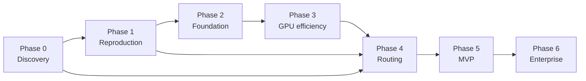

# Execution Plan

| Field | Value |
|---|---|
| Status | Foundation |
| Last updated | 2026-11-27 |
| Related | [Milestones](MILESTONES.md), [risks](RISKS.md), [open questions](OPEN_QUESTIONS.md), [progress](PROGRESS.md) |

## 1. Purpose

This plan converts the product requirements and architecture decisions into an ordered sequence of work. It is intentionally gated: later milestones depend on evidence from earlier ones. Calendar dates are not committed until the code audit is complete.

## 2. Working rules

- No application code is written until Milestone 0 and Milestone 1 produce their artifacts.
- Each milestone has explicit exit criteria and evidence requirements.
- A milestone is not complete because work was performed; it is complete when its evidence exists.
- Scope changes go through the open-questions and ADR process.
- Cost and quality claims require measured evidence.
- Dependencies on founder-owned artifacts are tracked, not assumed.

## 3. Phase 0 — Discovery and code audit

**Goal:** understand the existing system well enough to reproduce it and to plan the product accurately.

Workstreams:

1. Collect founder artifacts:
   - pod setup scripts
   - resident InfiniteTalk server
   - ComfyUI workflow generator
   - voice similarity scripts
   - mouth-opening metrics
   - HyperFrames editorial builder
   - procedural SFX scripts
   - Claude Code skill files
   - plate sheet examples
   - reference input/output media
2. Map the actual execution sequence and dependencies.
3. Identify which scripts can be wrapped, which must be ported and which should be replaced.
4. Record model versions, settings, hardware and observed timings.
5. Identify missing or undocumented steps.
6. Review licences for all models, tools and assets.
7. Produce an audit report.

Exit criteria:

- Audit report exists and is reviewed.
- A reproducible list of inputs, scripts and settings exists.
- Licence status is recorded for every component.
- Unknowns are recorded as open questions.
- The team can state what the first reproduction will cost and how long it will take.

## 4. Phase 1 — Reference reproduction

**Goal:** reproduce one existing 60-second short end to end through a controlled process, not through the coding assistant.

Workstreams:

1. Prepare a reference input package and approved script.
2. Execute the pipeline using the audited scripts.
3. Record exact versions, hardware, timings, cost, retries and failures.
4. Run QC and store evidence.
5. Obtain founder acceptance in a blind comparison.
6. Document undocumented manual steps.
7. Measure a repeat run in the same style.

Exit criteria:

- One 60-second short is reproduced and accepted.
- Two run manifests exist (first and repeat) with cost and timing.
- QC evidence is stored.
- Variance against the founder's reported figures is explained.
- The reproduction can be repeated by another engineer from the documented steps.

## 5. Phase 2 — Standalone execution foundation

**Goal:** create the application foundation and integrate existing scripts one stage at a time.

Workstreams:

1. Scaffold the repository structure.
2. Implement domain models, state machines and invariants.
3. Implement PostgreSQL schema and migrations.
4. Implement object storage adapter.
5. Implement job engine with leases and retries.
6. Implement provider adapters for voice, image, motion, presenter and lip-sync.
7. Implement GPU lifecycle adapter.
8. Integrate one stage at a time, starting with the cheapest and most deterministic.
9. Add observability and cost instrumentation.
10. Add a minimal web UI for run status and artifacts.

Exit criteria:

- A run can be created from an approved plan.
- At least one stage runs through the application with real inference.
- Job state, cost and provenance are recorded.
- Failures are visible and recoverable.

## 6. Phase 3 — GPU efficiency

**Goal:** reduce waste from provisioning and model loading.

Workstreams:

1. Implement resident model servers and warm pools.
2. Implement compatible-job batching.
3. Implement preflight validation.
4. Implement idle shutdown and watchdog.
5. Implement cost metering and budget controls.
6. Measure before and after on the reference run.

Exit criteria:

- Model loading time per accepted output is measured and reduced.
- No orphaned GPU sessions during a normal run.
- Cost per accepted output is compared with the Phase 1 baseline.
- Quality is unchanged.

## 7. Phase 4 — Model abstraction and routing

**Goal:** make providers and models replaceable and evaluate alternatives without sacrificing quality.

Workstreams:

1. Implement model registry and routing policy.
2. Move all model references out of domain code.
3. Implement licence and egress gates.
4. Evaluate open alternatives against the quality gates.
5. Record evaluation results and routing decisions.
6. Keep premium baselines where they win.

Exit criteria:

- A model can be added or replaced without code changes.
- At least one open alternative has a completed evaluation record.
- Routing decisions are stored and reviewable.
- Quality floors are enforced.

## 8. Phase 5 — Product MVP

**Goal:** package the capability into a usable single-workspace product.

Workstreams:

1. Project, script and plate-sheet management UI.
2. Approval workflows and review UI.
3. Shot-level regeneration.
4. Progress tracking and cost visibility.
5. Final QC and export.
6. Run recovery and cancellation.
7. Security and retention controls.
8. Documentation and runbooks.

Exit criteria:

- All P0 capabilities in [MVP_SCOPE.md](MVP_SCOPE.md) are implemented and tested.
- The MVP acceptance criteria are met.
- A real 60-second short is produced through the product and accepted by the founder.

## 9. Phase 6 — Enterprise readiness

**Goal:** investigate and, if justified, implement multi-user, private and enterprise capabilities.

Workstreams:

1. Multi-tenancy and isolation review.
2. Private deployment and customer-managed inference.
3. Access control, SSO and SCIM.
4. Data retention and audit export.
5. Compliance investigation.
6. Pricing and packaging.

Exit criteria:

- Enterprise requirements are documented and prioritised.
- A decision is made on whether to pursue enterprise features and in what order.

## 10. Dependencies

Phase 4 depends on Phase 1 evidence and Phase 0 licence review, not only on Phase 3. Starting routing work before reproduction is complete risks optimising the wrong baseline.

## 11. Definition of done (any phase)

- Exit criteria are met with evidence.
- Documentation matches the shipped behaviour.
- Tests and validation have been run and recorded.
- Costs and quality are measured and compared with the baseline.
- Open questions are updated.
- The next phase's entry criteria are satisfied.

## 12. Immediate next action

Begin Milestone 0 by requesting the founder's existing artifacts and scheduling the code audit. Do not scaffold application code until the audit report exists.

## 13. Open questions

- The availability and completeness of the founder's existing scripts and media.
- The effort required to wrap versus port each script.
- Whether the reference reproduction can be run within the current paid accounts.
- The order in which stages should be integrated into the application.

Tracked in [OPEN_QUESTIONS.md](OPEN_QUESTIONS.md).
