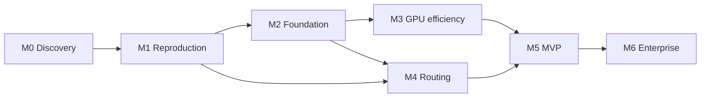

# Implementation Roadmap

| Field | Value |
|---|---|
| Status | Foundation; effort estimates are provisional |
| Last updated | 2026-11-27 |
| Related | [Execution plan](EXECUTION_PLAN.md), [milestones](MILESTONES.md), [risks](RISKS.md), [environment setup checklist](ENVIRONMENT_SETUP_CHECKLIST.md) |

## 1. Purpose

This roadmap breaks the product into dependency-aware engineering milestones. It expands the milestones with objectives, deliverables, dependencies, estimated effort, acceptance criteria, testing requirements and risks.

Effort is expressed in engineering-weeks and is provisional until the code audit.

## 2. Roadmap

### Milestone 0 — Discovery and code audit

- **Objective:** understand the existing system and its licences.
- **Deliverables:** audit report, dependency map, licence review, gap list.
- **Dependencies:** founder artifacts.
- **Effort:** 1–2 engineering-weeks.
- **Acceptance:** reproduction requirements and costs are known; every component has a licence status.
- **Testing:** none (documentation and audit).
- **Risks:** missing artifacts, undocumented steps, licence surprises.

### Milestone 1 — Reference reproduction

- **Objective:** reproduce one 60-second short end to end.
- **Deliverables:** reproduced video, two run manifests, QC evidence, founder acceptance note.
- **Dependencies:** Milestone 0.
- **Effort:** 2–4 engineering-weeks.
- **Acceptance:** AC-REP-001 through AC-REP-010.
- **Testing:** QC measurement, cost reconciliation, repeat-run comparison.
- **Risks:** reproduction variance, cost overrun, quality mismatch.

### Milestone 2 — Standalone execution foundation

- **Objective:** create the application foundation and integrate one stage at a time.
- **Deliverables:** scaffold, domain models, database, storage, job engine, provider adapters, GPU adapter, minimal UI, observability.
- **Dependencies:** Milestone 1.
- **Effort:** 6–10 engineering-weeks.
- **Acceptance:** a run can be created; at least one stage runs with real inference; failures are recoverable.
- **Testing:** unit, integration, contract, end-to-end with synthetic media.
- **Risks:** integration effort, state-machine complexity, provider adapter edge cases.

### Milestone 3 — GPU efficiency

- **Objective:** reduce waste from provisioning and model loading.
- **Deliverables:** resident pools, batching, preflight, idle shutdown, watchdog, cost metering.
- **Dependencies:** Milestone 2.
- **Effort:** 3–5 engineering-weeks.
- **Acceptance:** loading waste measured and reduced; no orphaned sessions; quality unchanged.
- **Testing:** GPU lifecycle tests, chaos tests, cost comparison.
- **Risks:** provider termination reliability, idle cost, complexity.

### Milestone 4 — Model abstraction and routing

- **Objective:** make providers and models replaceable and evaluate alternatives.
- **Deliverables:** registry, routing policy, licence and egress gates, one completed evaluation.
- **Dependencies:** Milestones 1 and 2.
- **Effort:** 3–5 engineering-weeks.
- **Acceptance:** model can be added without code changes; quality floors enforced.
- **Testing:** routing tests, evaluation runs, licence checks.
- **Risks:** registry hygiene, quality floor calibration.

### Milestone 5 — Product MVP

- **Objective:** package the capability into a usable single-workspace product.
- **Deliverables:** project/plan management, approvals, shot regeneration, progress, QC, export, security/retention controls, runbooks.
- **Dependencies:** Milestones 2, 3 and 4.
- **Effort:** 8–12 engineering-weeks.
- **Acceptance:** all P0 capabilities and MVP acceptance criteria.
- **Testing:** full test pyramid, security, operational, UX.
- **Risks:** scope creep, UX complexity, release readiness.

### Milestone 6 — Enterprise readiness

- **Objective:** investigate and prioritise enterprise capabilities.
- **Deliverables:** multi-tenancy review, private deployment design, SSO/SCIM investigation, compliance investigation, roadmap.
- **Dependencies:** Milestone 5 and customer input.
- **Effort:** 2–4 engineering-weeks.
- **Acceptance:** requirements documented and prioritised.
- **Testing:** design review.
- **Risks:** premature scope, unvalidated enterprise assumptions.

## 3. Critical path

Milestone 4 can start after Milestone 1 and Milestone 2; it must not be started before the baseline is reproduced.

## 4. Dependency notes

- M2 depends on M1 because the integration order and cost baseline must be known.
- M3 depends on M2 because GPU lifecycle code must exist.
- M4 depends on M1 and M2, not only M3.
- M5 depends on M2, M3 and M4.
- M6 depends on M5 and real customer input.

## 5. What not to do early

- Do not scaffold services before M0/M1.
- Do not install heavy dependencies before they are needed.
- Do not download model weights before M1.
- Do not provision GPUs before M1.
- Do not start enterprise features before M5.

## 6. Open questions

- Effort estimates need validation after the code audit.
- Whether M3 and M4 can partially overlap.
- Whether M5 can ship with a subset of P1 features.

Tracked in `docs/project/OPEN_QUESTIONS.md`.
